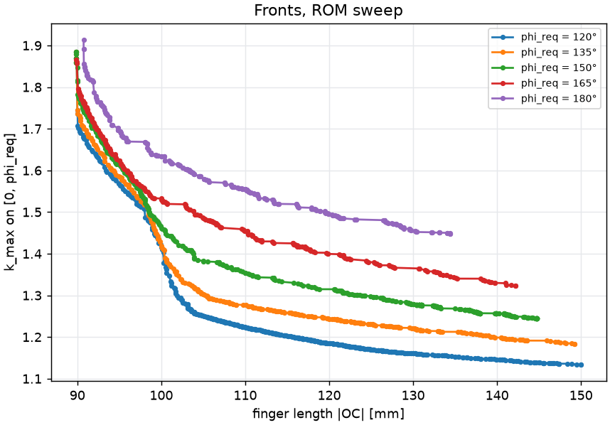
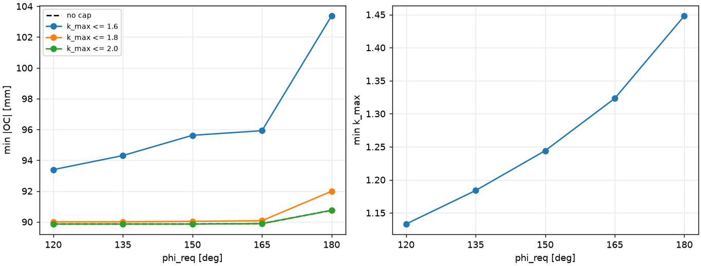
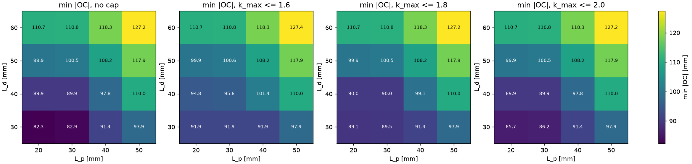
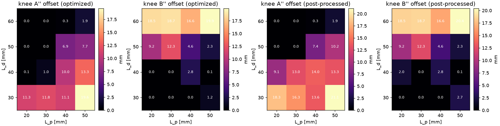

# CoDe Linkage — Formulation v2 and Exploratory Sweeps

> **2026-10-26:** formulation v2 (`linkage-v2-rev2`) and its sweep script were removed; the last code is `03cfbc5`. The current study is `scripts/optimize/linkage/config.yaml` (formulation `linkage-v3`). The v2 runs are kept in `output/legacy/linkage_v2` but no longer load with the current code.

*2026-10-23 · Dongho · branch `feature/2dof-fe`. Baseline v1 `303852e` (local tag `formulation-v1.x-baseline`, not pushed); formulation v2 `4e27140` and `0594912` (formulation id `linkage-v2-rev2`); sweep script and this report in the Phase 3 commit.*

The framework's question is: *given the contact-interface requirements, what finger morphology fits them?* Formulation v2 treats the interface as an input. The pads' mounting lengths L<sub>p</sub> and L<sub>d</sub> are the longest modules to accommodate. The required ROM φ<sub>req</sub> is a constraint. The optimizer minimizes transmission (k<sub>max</sub>) and finger length (|OC|). The sweeps below measure how the best achievable finger changes with φ<sub>req</sub>, L<sub>p</sub> and L<sub>d</sub>, so those requirements can be chosen from data.

## 1. Summary

- **Formulation v1 still reproduces.** Re-verifying the saved production v1 front gives hypervolume 18.719354, the recorded value. A fresh v1 run gives 18.586, within the run-to-run spread.
- **Formulation v2 is implemented and tested** (177 tests pass). A″ and B″ are now both free design variables, so the two pads can trade the joint space.
- **Single NSGA-II runs do not converge for v2.** The sweep therefore used 3–6 independent runs of 1000 generations per condition. In addition, each condition took one run warm-started from its harder neighbours, and its final front also includes their verified designs (§5). The monotonicity check passes after these measures. Convergence is therefore judged by leave-one-out and by how little the merged front changes when seeds are added.
- **Key results** (φ<sub>req</sub> 150° unless stated; minimum |OC| without a k<sub>max</sub> cap):
  - The proximal pad is cheap up to L<sub>p</sub> = 30 mm: going from 20 to 30 mm costs ≤ 0.6 mm of finger length. Each further 10 mm costs 6.5–12 mm.
  - The distal pad costs finger length from the start: each 10 mm of L<sub>d</sub> adds 6.5–12 mm.
  - φ<sub>req</sub> barely changes the shortest finger (89.9 mm from 120° to 165°, 90.7 mm at 180°). It raises the least k<sub>max</sub> at a growing rate: 1.13, 1.18, 1.24, 1.32, 1.45 from 120° to 180°.
  - The least k<sub>max</sub> at 150° is 1.244–1.250 for every pad pair. Pad lengths set the length, not the best transmission.
- **One search limit drives every front:** BC sits on its 15 mm lower bound in 96 % of front designs. Below 15 mm, BC keeps falling toward zero, with C next to B. A physical minimum for BC is needed (open question 1).

## 2. Formulation v2

| Role | Item | v2 setting (`scripts/optimize/linkage_v2/config.yaml`) |
|---|---|---|
| Objective | k<sub>max</sub> | Worst \|dφ/dθ<sub>servo</sub>\| (servo torque per held distal moment) on [0, φ<sub>req</sub>] |
| Objective | L<sub>finger</sub> | \|OC\| in the extended pose, C = (B<sub>x</sub> + BC, B<sub>z</sub>), B as assembled on the 0.1 mm machining grid |
| Input | L<sub>p</sub>, L<sub>d</sub> | `module_max_length_p` 30 mm, `module_max_length_d` 40 mm. These are the longest modules to accommodate, enforced as the least mounting-line a–b length including the A″ / B″ extensions |
| Input | φ<sub>req</sub> | 150°, distal rotation relative to OA (φ = q<sub>PIP</sub> + q<sub>DIP</sub>, unchanged from v1) |
| Input | Pads | Height 10 mm (mounting interface included), 45° chamfer 2.5 mm |
| Input | Stopper margin | `flexion_stopper_margin_deg` 0: the motion must stay danger-free this far past φ<sub>req</sub>. It no longer shortens the usable range |
| Input | Servo tilt | 20°, fixed |
| Input | Packaging | As v1. XM335 servos; Ø8 pivot housings with 1 mm clearance; A pin clear of a Ø7 zone at A′; B′ pin may cross the PIP servo body; pads 1 mm from the MCP servo; PIP servo above OA |
| Constraint | Danger-free on [0, φ<sub>req</sub> + margin] | No pad collision (2D blocks, MCP 0–90°), C<sub>x</sub> ≥ 0 at MCP 0° (least over the interval), assembly, transmission margin ≥ 30°, no DIP or PIP backoff |
| Constraint | Linkage validity from the hyperextension stopper (−10° PIP) | As v1: safe to the stopper; backoffs counted from there |
| Constraint | Pads | Proximal a–b ≥ L<sub>p</sub>, distal a–b ≥ L<sub>d</sub>; static packaging checks as v1 |
| Variables | 12 | A<sub>x</sub>, B<sub>x</sub>, B<sub>z</sub> (0), A′<sub>x</sub>, A′<sub>z</sub>, B′<sub>x</sub>, B′<sub>z</sub>, tilt (input), BC, A<sub>z</sub> (0), A″ offset (A″<sub>x</sub> − A′<sub>x</sub>, 0–20 mm), B″ offset (B′<sub>x</sub> − B″<sub>x</sub>, 0–20 mm) |
| Search limits | Bounds | \|OC\| 40–150 mm, BC 15–60 mm, A<sub>x</sub> / A′<sub>x</sub> 5–140 mm, B<sub>x</sub> 20–140 mm, A′<sub>z</sub> 0–25 mm, B′<sub>x</sub> −50–200 mm, B′<sub>z</sub> −60–80 mm |
| Post-processing | `extension_priority: balanced` | Lengthen both pads past the optimized A″ / B″ in alternating 0.5 mm steps while k<sub>max</sub>, \|OC\| and feasibility hold with 0.5 mm extra clearance; re-verified on the 0.05° grid |
| Hypervolume | Reference point | k<sub>max</sub> = 2.3, \|OC\| = 150 mm (the \|OC\| search upper bound) |

### 2.1 What changed in the code

- **B″.** B″ was not a design variable before. It was derived as B″ = (B′<sub>x</sub>, B<sub>z</sub>), B′ projected on the distal mounting line in the reference pose, measured from B along BC. It is now B″ = (B′<sub>x</sub> − `bpp_offset_mm`, B<sub>z</sub>). A″ works the same way distally. Older design vectors read with both offsets 0. v1 configs hold them at 0, so v1 is unchanged.
- **C<sub>x</sub>.** The old rule, C<sub>x</sub> ≥ 0 at the end of the usable range, is replaced by the least C<sub>x</sub> over the danger-free interval. A design that could curl behind O after φ<sub>req</sub> is now stopped there, not rejected (decision D3).
- **v1 and v2 k<sub>max</sub>.** v1's k<sub>max</sub> does **not** include the hyperextension range (−10°…0°); both start at extension. They differ only in where the interval ends. v1 ends it at each design's own usable end (φ<sub>safe</sub> less a 5° stopper margin); v2 ends it at φ<sub>req</sub>. The values are therefore comparable only for designs whose usable end equals φ<sub>req</sub>.
- **Config independence.** The v2 config pins every formulation value and does not extend the v1 study config. That inheritance is what broke `production_v1.yaml` (§3).

## 3. Regression of formulation v1

`production_v1.yaml` extended `config.yaml`. When `config.yaml` moved to 10 mm pads, `production_v1.yaml` silently took them too. It now pins the 5 mm pads and matches all 15 recorded runs field by field.

| Check | Result |
|---|---|
| Primary: re-verify the saved production v1 front (15 runs) with the current code | 416 designs, hypervolume **18.719354**, identical to the recorded front. Rechecked after B″ was added: same |
| Secondary: one new v1 run (NSGA-II, seed 0, 200 × 400) | Hypervolume **18.586**. Earlier single runs: 17.39–18.53; their 15-run merge: 18.72 |

The search space grew from 10 to 12 variables, so the same seed draws a different start and exact reproduction is not possible.

## 4. Convergence on the baseline condition

L<sub>p</sub> 30, L<sub>d</sub> 40, φ<sub>req</sub> 150°; NSGA-II, population 200; three seeds. Each front is re-verified on the 0.05° grid before measuring.

| Generations | Hypervolume (seeds 0 / 1 / 2) | Spread | Least k<sub>max</sub> | Least \|OC\| (mm) |
|---|---|---|---|---|
| 200 | 46.0 / 50.1 / 43.5 | 14.2 % | 1.276–1.280 | 96.6–103.7 |
| 400 | 46.7 / 54.2 / 47.5 | 15.1 % | 1.270–1.278 | 90.7–102.4 |
| **1000** | **55.8 / 55.3 / 55.0** | **1.5 %** | 1.263–1.277 | **90.0–90.5** |

At 1000 generations the best single run reaches 99.5 % of the three-run merge. The sweep therefore used **1000 generations × 3 seeds** per condition, about 3.4 minutes per run on 8 cores. This replaces the single-run development protocol, which did not converge here. With 11 variables (before B″) more generations did not help, but with 12 they did: freeing B″ opens shorter fingers that take longer to find.

## 5. Making the sweep converge

A first pass of 3 independent runs per condition produced 23 monotonicity violations. The constraints are nested, so these signal non-convergence. For example, min |OC| at φ<sub>req</sub> 135° (101.3 mm) exceeded the value at 150° (90.0 mm). Leave-one-out was 69–99 %. Three measures followed, all reported here:

1. **More independent seeds.** The two hardest corners (φ<sub>req</sub> 180°; L<sub>p</sub> 50 / L<sub>d</sub> 60) got seeds 3–5. So did the six conditions whose leave-one-out stayed below 95 % after step 2.
2. **One warm-started run per condition.** Conditions were run in order from hardest to easiest. Each got one extra 1000-generation run (seed 10) with up to half its population drawn from its harder neighbours' verified fronts, spread along |OC|. A harder neighbour is one step up in φ<sub>req</sub>, L<sub>p</sub> or L<sub>d</sub>.
3. **Inherited candidates.** Each condition's final front is the verified non-dominated set of its own runs' candidates **plus** its harder neighbours' verified fronts, re-verified on this condition's 0.05° grid. Every design feasible under a harder condition is feasible here with the same |OC| and at most the same k<sub>max</sub>.
   - Why it was needed: without it, a coarse-grid design could dominate a valid inherited design inside the optimizer and then fail fine verification, and both were lost. This happened at φ<sub>req</sub> 135°.

After these steps the monotonicity check passes, but **by construction**. It therefore no longer tests convergence. Convergence is judged instead by leave-one-out (the share of the merged front's hypervolume the condition's other runs reach when one is dropped) and by how much the merged front moved when seeds 3–5 were added:

- Adding seeds 3–5 changed the six weakest merged fronts by +0.00 to +0.15 % of hypervolume.
- Leave-one-out stays low for φ<sub>req</sub> 135° (87 %) and 120° (93 %). The independent runs there are weak, and their fronts rest on the warm-started run and inherited designs.
- The easiest conditions take much of their front from harder neighbours. At L<sub>p</sub> 20 / L<sub>d</sub> 30, 1014 of 1191 front designs are inherited. Their minima are upper bounds: a shorter finger may exist there.

## 6. Results

Figures are in `docs/figures/linkage_v2/`. The full per-condition data (fronts, knee designs, bound hits) is in `output/linkage_v2/sweeps/summary.json`.

### 6.1 ROM sweep (L<sub>p</sub> 30, L<sub>d</sub> 40)

| φ<sub>req</sub> | Runs | Least k<sub>max</sub> | Least \|OC\| (mm) | at k ≤ 1.6 | at k ≤ 1.8 | at k ≤ 2.0 | Hypervolume | Leave-one-out | Feasible evals |
|---:|---:|---:|---:|---:|---:|---:|---:|---:|---:|
| 120° | 7 | 1.133 | 89.9 | 93.4 | 90.0 | 89.9 | 63.00 | 93.3 % | 29.7 % |
| 135° | 7 | 1.184 | 89.9 | 94.3 | 90.0 | 89.9 | 60.10 | 87.4 % | 21.6 % |
| 150° | 4 | 1.244 | 89.9 | 95.6 | 90.0 | 89.9 | 56.51 | 99.2 % | 20.3 % |
| 165° | 4 | 1.323 | 89.9 | 95.9 | 90.1 | 89.9 | 52.06 | 99.1 % | 22.1 % |
| 180° | 6 | 1.448 | 90.7 | 103.4 | 92.0 | 90.7 | 45.61 | 98.4 % | 25.9 % |




### 6.2 Pad grid (φ<sub>req</sub> 150°): least |OC| (mm), no k<sub>max</sub> cap

| L<sub>d</sub> \ L<sub>p</sub> | 20 | 30 | 40 | 50 |
|---|---:|---:|---:|---:|
| **60** | 110.7 | 110.8 | 118.3 | 127.2 |
| **50** | 99.9 | 100.5 | 108.2 | 117.9 |
| **40** | 89.9 | 89.9 | 97.8 | 110.0 |
| **30** | 82.3 | 82.9 | 91.4 | 97.9 |

With k<sub>max</sub> ≤ 1.6 the bottom-left cells rise. At L<sub>d</sub> 30 they become 91.9 / 91.9 / 91.9 / 97.9; at L<sub>d</sub> 40 they become 94.8 / 95.6 / 101.4 / 110.0. From L<sub>d</sub> 50 up, the cap binds by at most 0.2 mm. Least k<sub>max</sub> is 1.244–1.250 in every cell. Leave-one-out is 94–99 % across the grid (L<sub>p</sub> 30 / L<sub>d</sub> 60: 94.1 %).



### 6.3 Knee designs

The knee is the front design nearest the ideal point, with both objectives scaled to [0, 1] over the front. Pad lengths are shown as optimized → post-processed (`balanced`, 0.5 mm extra clearance, re-verified on the 0.05° grid). All knees stay feasible after post-processing, with k<sub>max</sub> unchanged.

| Condition | k<sub>max</sub> | \|OC\| | Proximal a–b | Distal a–b | A″ offset | B″ offset |
|---|---:|---:|---|---|---|---|
| φ 150°, L<sub>p</sub> 30, L<sub>d</sub> 40 (baseline) | 1.389 | 103.9 | 31.5 → 43.5 | 40.3 → 40.3 | 1.0 → 13.0 | 0.0 → 0.0 |
| φ 120° | 1.262 | 103.6 | 41.0 → 46.0 | 40.0 → 40.0 | 11.9 → 16.9 | 0.3 → 0.3 |
| φ 180° | 1.592 | 103.9 | 35.0 → 35.0 | 46.7 → 47.2 | 0.0 → 0.0 | 12.7 → 13.2 |
| L<sub>p</sub> 20, L<sub>d</sub> 30 | 1.487 | 95.1 | 40.4 → 47.4 | 30.2 → 30.2 | 11.3 → 18.3 | 0.0 → 0.0 |
| L<sub>p</sub> 50, L<sub>d</sub> 30 | 1.401 | 106.0 | 52.9 → 54.4 | 33.0 → 34.5 | 19.6 → 21.1 | 1.2 → 2.7 |
| L<sub>p</sub> 30, L<sub>d</sub> 60 | 1.360 | 115.8 | 33.5 → 33.5 | 61.3 → 61.3 | 0.0 → 0.0 | 18.7 → 18.7 |
| L<sub>p</sub> 50, L<sub>d</sub> 60 | 1.377 | 130.2 | 50.0 → 50.0 | 60.6 → 61.1 | 1.9 → 1.9 | 19.9 → 20.4 |

The A″ / B″ pattern over the grid is shown below:

- The optimizer uses the **A″ extension when L<sub>d</sub> is small** and the **B″ extension when L<sub>d</sub> is large**.
- Post-processing mostly lengthens the proximal pad. At the baseline the knee's proximal pad grows from 31.5 to 43.5 mm at no cost.
- The B″ offset reaches its 20 mm limit at L<sub>d</sub> 60 (bound hits in §7).



## 7. Bound hits

The table counts front designs within 0.5 % of a search limit, summed over all 20 conditions (9616 front designs).

| Limit | Front designs | Where |
|---|---:|---|
| BC = 15 mm (lower) | 9268 (96 %) | Every condition |
| B″ offset = 0 (lower) | 4411 | Mostly small L<sub>d</sub> |
| A″ offset = 0 (lower) | 2051 | Mostly large L<sub>d</sub> |
| B″ offset = 20 mm (upper) | 300 | L<sub>d</sub> 50–60 |
| B′<sub>z</sub> = 80 mm (upper) | 312 | φ<sub>req</sub> 120° and 135° only |
| \|OC\| = 150 mm (upper) | 3 | φ<sub>req</sub> 120° (the long-finger end of the front) |

Zero offsets are not search limits in a physical sense: they mean that pad gains nothing from running past A′ or B′. The binding ones are:

- **BC, everywhere.** An earlier probe with 11 variables lowered the limit to 1 mm. 181 of 200 front designs then went to 1 mm: C right next to B, with the distal pad hung behind B toward B′.
- **The B″ upper limit, at large L<sub>d</sub>.**
- **B′<sub>z</sub> at low φ<sub>req</sub>.** The 120° and 135° fronts may improve with a wider B′<sub>z</sub> limit.

## 8. Monotonicity check

| Stage | Violations |
|---|---|
| First pass (3 independent runs × 1000 generations per condition) | 23 (8 in least \|OC\| or capped \|OC\|, 15 in least k<sub>max</sub>) |
| After extra seeds, warm-started runs and inherited candidates (§5) | **0** |

Every value in §6 comes from the final stage. No first-pass value is quoted as a result.

## 9. Open questions

1. **Minimum BC.** *Decided 2026-10-23: BC ≥ 25 mm (`scripts/optimize/linkage_v2/config.yaml`). The results above were run with BC ≥ 15 mm and are superseded once the sweep is rerun.* BC rests on its 15 mm search limit across all fronts and would collapse toward 0 without it. Every length in §6 is conditional on BC ≥ 15 mm. A physical requirement is needed: fingertip length beyond the B pin, B-pin housing plus a tip, or a distal-segment ratio. The sweeps should be repeated once it is set.
2. **φ<sub>req</sub>.**
   - Finger length is nearly independent of φ<sub>req</sub> up to 165°. Transmission is not: the least k<sub>max</sub> rises by 0.05, 0.06, 0.08 and 0.13 per 15° step from 120° to 180°.
   - Under a k<sub>max</sub> ≤ 1.6 cap, the shortest finger grows slowly to 165° (93.4 → 95.9 mm), then jumps to 103.4 mm at 180°.
   - Candidate: **φ<sub>req</sub> = 150–165°.** 180° costs about 8 mm of finger length under the 1.6 cap and about 0.13 in k<sub>max</sub> over 165°.
3. **L<sub>p</sub> and L<sub>d</sub>, and the asymmetry between them.**
   - Proximal length is nearly free up to 30 mm: 20 → 30 mm costs ≤ 0.6 mm at every L<sub>d</sub>. The crossed four-bar's joint space, used through the A″ extension, absorbs it.
   - Beyond 30 mm each 10 mm of L<sub>p</sub> costs 6.5–12 mm of finger.
   - Distal length costs 6.5–12 mm per 10 mm from the start.
   - Candidates: **L<sub>p</sub> = 30 mm**, since smaller saves nothing; **L<sub>d</sub> as small as the distal module allows (30–40 mm)**, since this is the costly requirement. If a larger total pad length is needed, adding it proximally costs less only up to L<sub>p</sub> 30; beyond that the two cost about the same.
4. **k<sub>max</sub> caps.** Capping k<sub>max</sub> at 1.6 adds up to 10 mm of finger length when both pads are small (L<sub>p</sub> ≤ 30, L<sub>d</sub> 30–40: +4.9 to +9.6 mm). It adds ≤ 3.6 mm at L<sub>p</sub> 40, nothing at L<sub>p</sub> 50, and ≤ 0.2 mm at L<sub>d</sub> ≥ 50, where fronts already lie below 1.6. A required transmission (from the external load case) would decide which column of §6.2 applies.
5. **Convergence at low φ<sub>req</sub> and the easiest pad pairs.** These fronts rest on warm-started and inherited designs (§5), so their minima are upper bounds. If φ<sub>req</sub> 120–135° or L<sub>d</sub> 30 become candidates, run more independent seeds with a wider B′<sub>z</sub> limit first.
6. **Post-processed pad capacity.** Knees gain up to 12 mm of proximal pad in post-processing, and rarely distal pad. The real proximal module capacity is therefore often well above L<sub>p</sub>. Whether to quote the post-processed length as the module capacity in the design is a team decision.

## Reproducing

```text
# formulation v1 regression
python scripts/optimize/select_seeds.py output/linkage/production_v1/run_0{01..15}
# v2 sweep (about 6 h on 8 cores in total)
python scripts/optimize/linkage_v2/sweep.py run --seeds 0 1 2 --generations 1000
python scripts/optimize/linkage_v2/sweep.py run --conditions <hardest corners> --seeds 3 4 5 --generations 1000
python scripts/optimize/linkage_v2/sweep.py run --conditions <hardest first> --seeds 10 --generations 1000 --warm-from-harder
python scripts/optimize/linkage_v2/sweep.py analyze --generations 1000
```

Result files stay in `output/linkage_v2/sweeps/`; they are not in git. Runs from before B″ was a variable are kept apart in `output/linkage_v2/obsolete/` and are not used.
