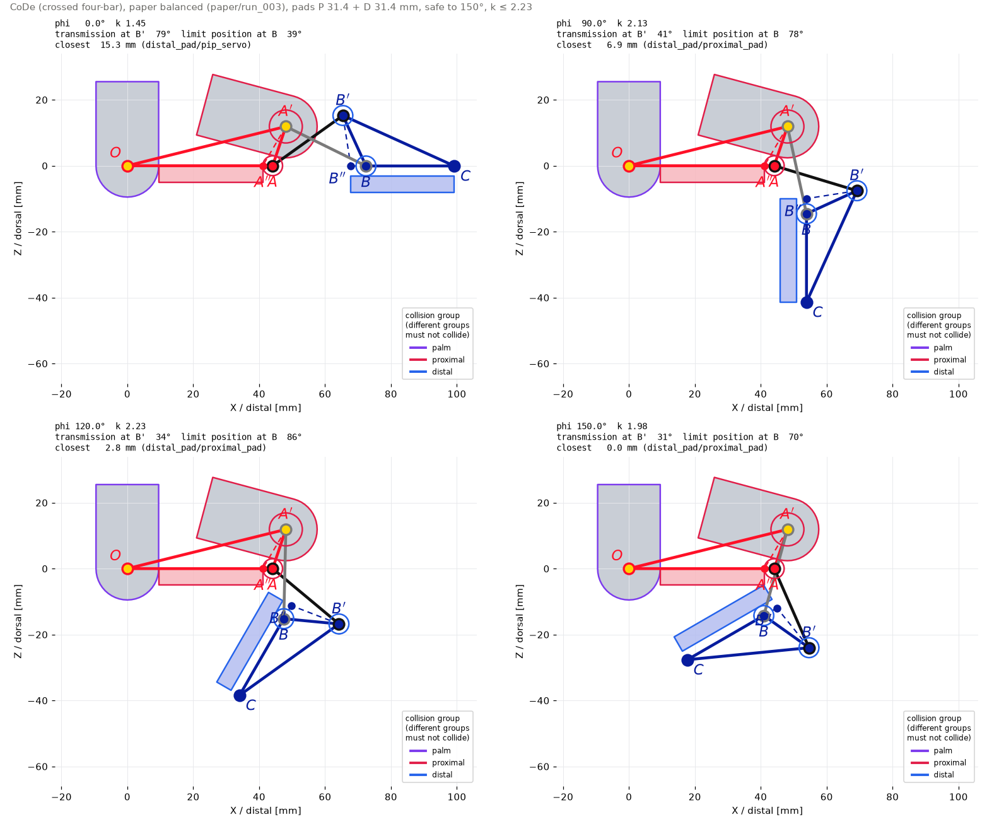

# CoDe prototype, rerun under the SSoT (2026-11-19)

> **Superseded in part (2026-11-19):** this run optimized $\bar C_{\mathrm{pad}}$ alone with independent pad mounting offsets, at commit `8e22534`'s parent. The prototype now searches $(\bar C_{\mathrm{pad}}, MA_{\mathrm{wc}})$ with aligned offsets; its results are in a separate report.

**Track: prototype optimization** (`design/scripts/optimize/prototype/`). Not a study result; its numbers are not compared
with the studies' (repository README, "Two optimizations: prototype and study").

## Setup

| Item | Value |
|---|---|
| Formulation | `design/SSoT/problem_formulation.md` A.5 (CoDe), one objective $\bar C_{\mathrm{pad}}$ |
| Config | `design/scripts/optimize/linkage/config.yaml` (now `prototype/`), preset `paper` (now `convergence`) |
| Goal | $L_f\in[90,100]$ mm, $q_{\mathrm{req}}=150^\circ$, $\gamma\in[30^\circ,150^\circ]$, $MA_{\min}=0.2$, PIP servo tilt $[15^\circ,15^\circ]$ |
| Optimizers | GA and NSGA-II, seeds 0, 1, 2; population 200, 3000 generations (600 000 evaluations per run) |
| Warm start | 100 of the 1075 feasible designs of `output/linkage/config/samples/seeds.csv` (resampled under the SSoT rules) |
| Verification | front re-evaluated on the 0.05° grid |
| Output | `design/output/linkage/config/paper_single_objective/` (`run_001`–`run_006`, `portfolio_001`) |

## Convergence

Best $\bar C_{\mathrm{pad}}$ found by each run, by generation:

| Run | Optimizer | gen 100 | gen 300 | gen 1000 | gen 2000 | gen 3000 | Last gain at gen |
|---|---|---|---|---|---|---|---|
| run_001 | GA, seed 0 | 0.710 | 0.710 | 0.715 | 0.715 | 0.716 | 2889 |
| run_002 | GA, seed 1 | 0.714 | 0.714 | 0.717 | 0.717 | 0.717 | 666 |
| run_003 | GA, seed 2 | 0.715 | 0.717 | 0.720 | 0.720 | **0.720** | 1115 |
| run_004 | NSGA-II, seed 0 | 0.711 | 0.711 | 0.711 | 0.711 | 0.711 | 90 |
| run_005 | NSGA-II, seed 1 | 0.710 | 0.710 | 0.711 | 0.712 | 0.713 | 2412 |
| run_006 | NSGA-II, seed 2 | 0.709 | 0.709 | 0.713 | 0.713 | 0.713 | 2221 |

Every run levels off well before the budget. The six runs end in different optima (0.711–0.720, a 1.3 % spread), so
the result is the best of six runs, not a proven global optimum. GA does better than NSGA-II on this single
objective.

## Design (portfolio_001, run_003)

*At $q_2=0^\circ$, $90^\circ$, $120^\circ$, $150^\circ$ (`python -m visualize.finger output/linkage/config/paper_single_objective/portfolio_001/seeds.csv balanced --phi 0 90 120 150`). At $150^\circ$ the distal pad touches the proximal pad.*

| Quantity | Value |
|---|---|
| $\bar C_{\mathrm{pad}}$ | **0.720** |
| $C_{\mathrm{pad}}$ at $q_2=90^\circ,\,120^\circ,\,150^\circ$ | 0.708, 0.714, 0.739 |
| Common length $\lvert T\rvert$ at those poses | 31.4, 30.9, 31.4 mm |
| $L_f(q)$ at those poses | 88.7, 86.7, 85.0 mm ($L_f(0)=99.2$ mm) |
| Pads, proximal pad + distal pad | 31.6 + 31.4 mm |
| $MA_{\mathrm{wc}}$ | 0.448 (≥ 0.2) |
| $\gamma$ over $[0,q_{\mathrm{req}}]$ | 30.9°–79.0° |
| $q_{\max}$ | 150.1° (the proximal pad meets the distal pad) |
| Least pad clearance | 0.006 mm |
| Active bound | `proximal_mount_offset_mm` at its lower bound |

Design vector (`variable_names` order): `a_x 44.1, b_x 72.4, b_z 0.0, ap_x 48.1, ap_z 11.9, bp_x 65.4, bp_z 15.3,
servo_tilt 15.0, bc 26.8, a_z 0.0, app_offset -7.0, bpp_offset -2.4, proximal_mount_offset 0.0,
distal_mount_offset 3.0` (mm, deg).

## Candidates

With one objective, each run returns one best design; merged and verified, they leave one non-dominated design
(run_003). The six run bests:

| Run | $\bar C_{\mathrm{pad}}$ | $C_{\mathrm{pad}}$ at 90° / 120° / 150° | $MA_{\mathrm{wc}}$ | $\gamma_{\min}$ | $L_f(0)$ mm | Pads P + D mm | Pad clearance mm |
|---|---|---|---|---|---|---|---|
| run_003 (GA 2) | **0.720** | 0.708 / 0.714 / 0.739 | 0.448 | 30.9° | 99.2 | 31.6 + 31.4 | 0.006 |
| run_002 (GA 1) | 0.717 | 0.703 / 0.713 / 0.735 | 0.452 | 35.7° | 99.9 | 31.3 + 31.1 | 0.006 |
| run_001 (GA 0) | 0.716 | 0.703 / 0.712 / 0.732 | 0.440 | 33.0° | 99.9 | 31.2 + 31.0 | 0.009 |
| run_006 (NSGA-II 2) | 0.713 | 0.698 / 0.713 / 0.729 | 0.435 | 30.1° | 99.9 | 31.1 + 30.6 | 0.002 |
| run_005 (NSGA-II 1) | 0.712 | 0.696 / 0.710 / 0.731 | 0.464 | 38.5° | 99.7 | 30.9 + 30.6 | 0.001 |
| run_004 (NSGA-II 0) | 0.711 | 0.695 / 0.710 / 0.729 | 0.445 | 35.2° | 99.4 | 30.7 + 30.3 | 0.001 |

All six reach $q_{\max}=150^\circ$ with the pads touching there, sit near the top of $L_f\in[90,100]$ mm and put
the proximal pad's mount at its lower bound: the same design family, within 1.3 % in $\bar C_{\mathrm{pad}}$.

## Reading

- The optimum lengthens both pads until they meet just past $q_{\mathrm{req}}$: $q_{\max}=150.1^\circ$ against
  $q_{\mathrm{req}}=150^\circ$, with the pads touching (clearance 0.006 mm). The coverage objective trades the
  flexion margin away, as the formulation allows ($q_{\max}$ is reported, not constrained).
- $MA_{\mathrm{wc}}=0.448$ is more than twice $MA_{\min}$; the transmission constraints are not active.
- The proximal pad sits as shallow as its mounting allows (active lower bound); a shallower mount is the next
  lever if the hardware permits it.

## Studies

This design does not enter Study 1 or Study 2. The studies' goal bounds $L_f\in[80,90]$ mm
(`design/scripts/study/base.yaml`) and this design's $L_f(0)=99.2$ mm lies outside it. The studies keep their
frozen reference (`references_nominal15.yaml`). Under the SSoT rules that reference stays feasible:
$\bar C_{\mathrm{pad}}=0.674$, $MA_{\mathrm{wc}}=0.408$ under `code_tilt15.yaml`.
