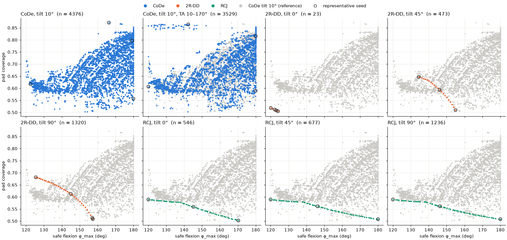
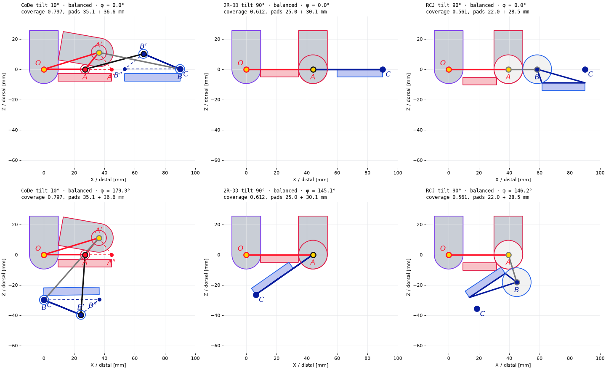

# 메커니즘 비교 study: CoDe vs 2R-DD vs RCJ (2026-11-05)

> **주의 (2026-11-05 추가).** 이 보고서의 수치는 아래 두 규칙이 바뀌기 전의 run에서 나왔다.
> 1. CoDe의 링크 규칙(`goal.loss.links_block_face`)이 추가됐다. φ_req에서 교차 링크가 pad 접촉면 앞을 지나는 구간은 접촉면으로 세지 않는다.
> 2. `pad_waste_mm` 제약이 삭제됐다.
>
> 특히 CoDe 결과는 B가 C에 붙은 설계(BC 0.1 mm)라서 링크 규칙에서는 성립하지 않는다. 다시 돌린 뒤 이 보고서를 갱신한다. 현재 프로토타입 정보는 [prototype.md](prototype.md)에 있다.

같은 goal과 같은 search 예산으로 세 가지 손가락 메커니즘을 최적화하고, 각 메커니즘이 얻는 pad coverage와 굽힘 범위를 비교했다.

- **CoDe**: crossed four-bar, `linkage`
- **2R-DD**: servo가 관절에 직접 붙은 serial 2R, `revolute`
- **RCJ**: rolling contact joint, `rcj`

## 요약

- **CoDe만 coverage를 높게 유지하면서 끝까지 굽힌다.**
  - 최대 coverage: 0.871.
  - 180°까지 굽히는 설계가 111개이고, 그중 최대 coverage는 0.854다.
  - 2R-DD는 180°까지 굽히는 설계가 하나도 없고, RCJ는 있어도 coverage가 0.508에 그친다.
- **2R-DD는 servo tilt에 따라 결과가 크게 달라진다.**
  - tilt 0°에서는 servo가 proximal pad 위를 덮는다. 그래서 pad가 9.5 mm 아래로 내려가고, 사실상 설계가 하나뿐이다(검증 통과 23개, coverage ≈ 0.51, φ_max ≈ 120–124°).
  - tilt 90°에서는 coverage가 0.681까지 오른다. 그래도 180°까지 굽히는 설계는 없다(최대 157°).
- **RCJ는 tilt에 관계없이 coverage 0.589에서 막힌다.**
  - roller 반지름이 servo를 감싸느라 9.5 mm로 정해진다. 이 roller가 proximal pad를 9.5 mm 깊이로 밀어내리고, 굽히면 distal roller가 그 pad에 부딪힌다.
  - 대신 180°까지 굽히는 설계는 있다(coverage 0.508).
- **CoDe의 transmission angle 제한을 30–150°에서 10–170°로 풀어도 front가 넓어지지 않는다.**
  - 최대 coverage(0.871 → 0.864)도, 180°에서의 최대 coverage(0.854 → 0.853)도 거의 같다.
  - 늘어난 것은 coverage 0.86 근처, φ_max 120–145°에 몰린 설계들로, 대부분 k가 큰 설계다(most_pad의 k_max 3.7).



*각 config의 검증된 non-dominated 설계를 φ_max(가로)와 coverage(세로)로 찍은 그림이다. 회색은 CoDe tilt 10°의 결과로, 비교 기준이다. 검은 원은 대표 seed다. 목적은 3개(transmission, coverage, curl)이므로, 이 2차원 그림에서는 서로 지배당하는 것처럼 보이는 점도 있다.*

## 설정

### Goal

공통 설정은 [scripts/study/base.yaml](../scripts/study/base.yaml)에 있고, 그 기반은 frozen baseline인 [scripts/study/baseline.yaml](../scripts/study/baseline.yaml)이다.

| 항목 | 값 |
|---|---|
| 손가락 길이 \|OC\| | 80–90 mm |
| 필요한 굽힘 (DIP flexion) | 120° |
| 분절 비율, four-bar span 비율 | 제약 없음 (물리 제약만) |
| pad 최소 길이 | proximal 20 mm, distal 25 mm |
| pad 두께 | 5 mm |
| pad 장착 깊이 | `shallowest_supported` 정책, 범위 [0, 10] mm, 두 pad를 따로 정함(`align_mount_offsets: false`) |
| 목적 | transmission, pad_coverage, curl |
| search 예산 | nsga2 / smsemoa / agemoea × seed 0, 1, 2 = 9 run, population 200, 1000세대 |

**장착 깊이 정책.** 각 pad의 깊이 d는 따로 정한다.
- **Case A**: pad가 자기 관절 hardware 밑으로 들어가지 않으면 d = 0이다.
- **Case B**: 들어가면 그 hardware를 피하는 가장 얕은 깊이로 정한다. 단, 그 hardware가 pad 위로 내려와 받쳐 줄 수 있는 깊이(native support)까지만 허용한다.
- **Case C**: 그보다 더 깊어야 하면 spacer가 필요하므로 설계에서 제외한다.

메커니즘별로 pad를 받쳐 주는 hardware는 다음과 같다.

| 메커니즘 | proximal pad | distal pad |
|---|---|---|
| CoDe | A/A′ pin housing, PIP servo | B/B′ pin housing |
| 2R-DD | servo | 없음 (output의 truss에 매달림) |
| RCJ | 자기 roller, servo | 자기 roller |

### Config

| config | 메커니즘 | 바꾼 것 | 걸린 시간 |
|---|---|---|---|
| `code_tilt10` | CoDe | PIP servo tilt 10° | 25분 |
| `code_tilt10_ta10` | CoDe | 위 설정 + transmission angle 10–170° | 26분 |
| `2r_dd_tilt0` | 2R-DD | servo tilt 0° | 41분 |
| `2r_dd_tilt45` | 2R-DD | servo tilt 45° | 38분 |
| `2r_dd_tilt90` | 2R-DD | servo tilt 90° | 36분 |
| `rcj_tilt0` | RCJ | servo tilt 0° | 25분 |
| `rcj_tilt45` | RCJ | servo tilt 45° | 25분 |
| `rcj_tilt90` | RCJ | servo tilt 90° | 26분 |

- 모든 run은 커밋 `7d01b6d`에서 돌렸다.
- 결과는 `output/study/<mechanism>/<config>/`(run_001–009, portfolio_001)에 있다. 이 폴더는 git으로 추적하지 않는다.

## 결과

### 메커니즘 비교

| config | 검증 통과 설계 | 최대 coverage | 최대 φ_max | 180°까지 굽히는 설계 수 / 그중 최대 coverage | balanced |
|---|---|---|---|---|---|
| CoDe tilt 10° | 4,376 | **0.871** | 180.0° | 111 / **0.854** | 0.797 @ 179.3° |
| CoDe tilt 10°, TA 10–170° | 3,529 | 0.864 | 180.0° | 156 / 0.853 | 0.816 @ 180.0° |
| 2R-DD tilt 0° | 23 | 0.519 | 124.1° | 0 / – | 0.512 @ 122.2° |
| 2R-DD tilt 45° | 473 | 0.647 | 155.0° | 0 / – | 0.593 @ 146.1° |
| 2R-DD tilt 90° | 1,320 | 0.681 | 157.4° | 0 / – | 0.612 @ 145.1° |
| RCJ tilt 0° | 546 | 0.589 | 170.3° | 0 / – | 0.559 @ 145.2° |
| RCJ tilt 45° | 677 | 0.589 | 180.0° | 6 / 0.508 | 0.561 @ 146.2° |
| RCJ tilt 90° | 1,236 | 0.589 | 180.0° | 10 / 0.508 | 0.561 @ 146.2° |

이 표의 값은 대표 seed만이 아니라 검증된 설계 전체에서 셌다.
- **180°까지 굽히는 설계**: φ_max ≥ 179.95°인 설계다.
- **balanced**: 대표 seed 중 balanced 역할의 값이다.

### Config별 대표 seed

- **k_max**: servo 토크와 distal 모멘트의 비(dφ/dθ)의 최댓값이다. 2R-DD는 구조상 항상 1, RCJ는 roller 비가 1:1이라 항상 2다.
- **깊이 P / D**: 각각 proximal pad와 distal pad의 장착 깊이다.
- **멈춘 이유**:
  - `pad_collision`: 괄호 안의 두 부품이 부딪혀서 멈췄다.
  - `curl`: 180°까지 굽혔다.
  - `transmission`, `dip_backoff`: CoDe의 기구 한계(transmission angle 한계, DIP 역회전)에서 멈췄다.
- role이 둘 이상 적힌 행은 같은 설계가 두 역할에 뽑힌 경우다.

#### CoDe, tilt 10° (`code_tilt10`)

| role | run · # | k_max | coverage | φ_max | pads P + D (mm) | 깊이 P / D (mm) | 멈춘 이유 |
|---|---|---|---|---|---|---|---|
| best_transmission | run_002 · 1 | 1.304 | 0.617 | 122.6° | 20.0 + 35.5 | 0.0 / 3.0 | pad_collision (distal pad / proximal pad) |
| most_pad | run_003 · 2142 | 2.485 | 0.871 | 166.3° | 52.4 + 26.0 | 0.4 / 3.0 | transmission |
| most_curl | run_009 · 1124 | 1.450 | 0.557 | 180.0° | 22.1 + 28.0 | 3.0 / 3.0 | curl |
| balanced | run_007 · 1888 | 1.552 | 0.797 | 179.3° | 35.1 + 36.6 | 3.0 / 3.0 | curl |

#### CoDe, tilt 10°, transmission angle 10–170° (`code_tilt10_ta10`)

| role | run · # | k_max | coverage | φ_max | pads P + D (mm) | 깊이 P / D (mm) | 멈춘 이유 |
|---|---|---|---|---|---|---|---|
| best_transmission | run_001 · 1 | 1.302 | 0.607 | 120.1° | 20.2 + 34.4 | 0.0 / 3.0 | dip_backoff |
| most_pad | run_001 · 1811 | 3.696 | 0.864 | 142.3° | 48.7 + 29.0 | 3.0 / 3.0 | dip_backoff |
| most_curl | run_005 · 1201 | 1.432 | 0.590 | 180.0° | 25.3 + 27.7 | 3.0 / 3.0 | curl |
| balanced | run_006 · 1921 | 1.635 | 0.816 | 180.0° | 37.1 + 36.3 | 3.0 / 3.0 | curl |

#### 2R-DD, tilt 0° (`2r_dd_tilt0`)

| role | run · # | k_max | coverage | φ_max | pads P + D (mm) | 깊이 P / D (mm) | 멈춘 이유 |
|---|---|---|---|---|---|---|---|
| best_transmission | run_001 · 2 | 1.000 | 0.508 | 123.2° | 20.3 + 25.5 | 9.5 / 0.0 | pad_collision (distal pad / proximal pad) |
| most_pad | run_001 · 11 | 1.000 | 0.519 | 120.1° | 20.2 + 26.5 | 9.5 / 0.0 | pad_collision (distal pad / proximal pad) |
| most_curl | run_001 · 3 | 1.000 | 0.505 | 124.1° | 20.3 + 25.2 | 9.5 / 0.0 | pad_collision (distal pad / proximal pad) |
| balanced | run_001 · 5 | 1.000 | 0.512 | 122.2° | 20.7 + 25.4 | 9.5 / 0.0 | pad_collision (distal pad / proximal pad) |

#### 2R-DD, tilt 45° (`2r_dd_tilt45`)

| role | run · # | k_max | coverage | φ_max | pads P + D (mm) | 깊이 P / D (mm) | 멈춘 이유 |
|---|---|---|---|---|---|---|---|
| best_transmission, most_curl | run_001 · 1 | 1.000 | 0.510 | 155.0° | 20.5 + 25.4 | 0.0 / 0.0 | pad_collision (distal pad / proximal pad) |
| most_pad | run_001 · 2 | 1.000 | 0.647 | 134.5° | 22.1 + 36.1 | 0.8 / 0.0 | pad_collision (distal pad / proximal pad) |
| balanced | run_001 · 15 | 1.000 | 0.593 | 146.1° | 24.4 + 29.0 | 0.0 / 0.0 | pad_collision (distal pad / proximal pad) |

#### 2R-DD, tilt 90° (`2r_dd_tilt90`)

| role | run · # | k_max | coverage | φ_max | pads P + D (mm) | 깊이 P / D (mm) | 멈춘 이유 |
|---|---|---|---|---|---|---|---|
| best_transmission | run_001 · 1 | 1.000 | 0.513 | 157.0° | 20.0 + 26.2 | 0.0 / 0.0 | pad_collision (distal pad / proximal pad) |
| most_pad | run_001 · 2 | 1.000 | 0.681 | 125.5° | 25.4 + 35.9 | 0.0 / 0.0 | pad_collision (distal pad / proximal pad) |
| most_curl | run_008 · 91 | 1.000 | 0.508 | 157.4° | 20.4 + 25.3 | 0.0 / 0.0 | pad_collision (distal pad / proximal pad) |
| balanced | run_001 · 16 | 1.000 | 0.612 | 145.1° | 25.0 + 30.1 | 0.0 / 0.0 | pad_collision (distal pad / proximal pad) |

#### RCJ, tilt 0° (`rcj_tilt0`, 모든 설계 roller r = 9.5 mm)

| role | run · # | k_max | coverage | φ_max | pads P + D (mm) | 깊이 P / D (mm) | 멈춘 이유 |
|---|---|---|---|---|---|---|---|
| best_transmission, most_curl | run_001 · 1 | 2.000 | 0.502 | 170.3° | 20.0 + 25.2 | 9.5 / 0.0 | pad_collision (distal roller / proximal pad) |
| most_pad | run_001 · 81 | 2.000 | 0.589 | 120.0° | 26.6 + 26.4 | 9.5 / 4.1 | pad_collision (distal roller / proximal pad) |
| balanced | run_001 · 8 | 2.000 | 0.559 | 145.2° | 24.2 + 26.1 | 9.5 / 5.0 | pad_collision (distal roller / proximal pad) |

#### RCJ, tilt 45° (`rcj_tilt45`, r = 9.5 mm)

| role | run · # | k_max | coverage | φ_max | pads P + D (mm) | 깊이 P / D (mm) | 멈춘 이유 |
|---|---|---|---|---|---|---|---|
| best_transmission, most_curl | run_001 · 2 | 2.000 | 0.508 | 180.0° | 20.3 + 25.4 | 7.0 / 2.0 | curl |
| most_pad | run_001 · 397 | 2.000 | 0.589 | 120.0° | 26.2 + 26.8 | 9.5 / 4.1 | pad_collision (distal roller / proximal pad) |
| balanced | run_002 · 17 | 2.000 | 0.561 | 146.2° | 24.2 + 26.3 | 9.0 / 5.3 | pad_collision (distal pad / proximal pad) |

#### RCJ, tilt 90° (`rcj_tilt90`, r = 9.5 mm)

| role | run · # | k_max | coverage | φ_max | pads P + D (mm) | 깊이 P / D (mm) | 멈춘 이유 |
|---|---|---|---|---|---|---|---|
| best_transmission, most_curl | run_001 · 2 | 2.000 | 0.508 | 180.0° | 20.6 + 25.1 | 7.0 / 2.0 | curl |
| most_pad | run_003 · 140 | 2.000 | 0.589 | 120.0° | 20.5 + 32.5 | 9.5 / 4.1 | pad_collision (distal roller / proximal pad) |
| balanced | run_001 · 17 | 2.000 | 0.561 | 146.2° | 22.0 + 28.5 | 5.3 / 9.0 | pad_collision (distal pad / proximal pad) |

### 대표 설계



*각 메커니즘에서 가장 좋은 config의 balanced 설계다. 위는 펴진 상태, 아래는 φ_max에서의 모습이다.*

## 해석

### CoDe

- pad 깊이가 0–3 mm로 얕다. proximal pad는 A/A′ 쪽 hardware, distal pad는 B pin housing이 정한다.
- 펼친 상태에서 순간 회전 중심이 움직이기 때문에, 굽힐 때 distal pad가 proximal pad를 비켜 간다.
- 그래서 pad를 길게(35 + 37 mm) 달아도 180° 가까이 굽힌다.
- 이것을 막는 것은 pad끼리의 충돌이 아니라 기구 자체의 한계다. 대표적으로 transmission angle과 DIP 역회전(dip_backoff)이 있다.

### 2R-DD

- 회전 중심이 A에 고정되어 있어서, 굽히면 distal pad가 곧바로 proximal pad 쪽으로 접혀 들어온다. 모든 대표 설계가 pad끼리 부딪혀서 멈췄다.
- **tilt 0°**: servo 몸체가 OA를 따라 누워 있어서 proximal pad가 그 아래 9.5 mm까지 내려간다. 그러면 접힐 때 두 pad가 더 빨리 만나서 120° 남짓에서 멈춘다.
- **tilt 45°, 90°**: servo가 일어서면서 두 pad 모두 깊이 0으로 붙일 수 있다. 그 결과 검증 통과 설계 수와 coverage가 함께 늘었다.

### RCJ

- 굴러가는 접촉 덕분에 회전 중심이 두 roller의 접점으로 옮겨 간다. 그래서 180°까지 굽히는 설계가 나온다.
- 하지만 roller가 servo 축과 둥근 앞부분을 감싸야 해서 반지름 하한이 9.5 mm다. 깊이 상한이 10 mm라 roller가 그보다 커질 수도 없어서, 사실상 9.5 mm에 고정된다.
- 그 결과 proximal pad가 roller 밑까지 오면 9.5 mm 깊이가 필요하고, 굽힐 때 distal roller가 이 pad에 닿는다.
- **servo tilt의 효과**:
  - tilt를 0° → 45° → 90°로 세우면 servo 아래가 비어서 검증 통과 설계 수가 546 → 677 → 1,236으로 늘어난다.
  - 그런데 대표 설계의 성능은 그대로다. servo가 일어서도 OA 아래에 남는 부분은 roller와 같은 원 하나뿐이기 때문이다.
  - proximal pad의 깊이를 정하는 것은 결국 pad 끝과 A roller 사이의 거리다.

### 예비 결과: ideal RCJ (PIP servo 없음)

정식 search가 아니라 quick run(smsemoa, seed 1개, 300세대)이므로 추세로만 본다.

ideal RCJ(`rcj_idealized`)는 servo 없이 다른 곳에서 구동한다고 가정한다.
- roller는 A와 B의 pin만 감싸면 되므로, 반지름 하한이 pin housing 3.0 mm로 내려간다.
- |AB| = 2r은 두 pin 간격 6 mm 이상이어야 한다.

| role | r (mm) | coverage | φ_max | pads P + D (mm) | 깊이 P / D (mm) |
|---|---|---|---|---|---|
| best_transmission | 4.8 | 0.680 | 175.3° | 29.2 + 31.8 | 0 / 0 |
| most_pad | 3.0 | 0.761 | 123.9° | 33.4 + 35.1 | 0 / 0 |
| most_curl | 5.0 | 0.668 | 180.0° | 30.2 + 29.4 | 0 / 0 |
| balanced | 4.0 | 0.717 | 154.6° | 31.3 + 33.2 | 0 / 0 |

- servo가 빠지자 최적화가 roller를 3–5 mm로 줄였다. 그러면 두 pad를 깊이 0으로 붙일 수 있다.
- 그 결과 coverage가 0.589 → 0.761로 오른다.
- 즉 servo가 있는 RCJ의 성능을 제한하는 것은 servo를 감싸느라 9.5 mm로 커진 roller다.
- 그래도 CoDe(0.871, balanced 0.797 @ 179°)에는 못 미친다.

## 한계와 주의할 점

- **충돌 모델**은 이상화된 2.5D 측면도다. 부품들이 Y 방향으로 서로 다른 층에 있다고 가정하며, 실제 3D 조립 공차는 반영하지 않는다.
- **RCJ**는 미끄럼 없이 구르는 이상적인 운동학만 다룬다. roller를 붙잡아 주는 교차 cable은 모델에 없으므로 모든 RCJ 설계는 잠정적이다.
- **2R-DD와 RCJ에서는 best_transmission이 사실상 의미가 없다.** k가 상수라서, 이 role은 다른 role과 같은 설계로 뽑히거나 임의의 설계가 된다.
- **`code_tilt10_ta10`의 출처 기록이 정확하지 않다.** 이 run은 ideal RCJ 코드 변경(커밋 전)이 작업 트리에 있는 상태에서 시작했다. `run.json`에는 `7d01b6d`로 기록되어 있다. 변경은 RCJ 쪽 분기에만 있어서 CoDe 결과에는 영향이 없다고 보지만, 엄밀하게는 다시 돌려야 한다.
- **φ_max**는 evaluator의 1° servo 격자에서 잰 값이다.

## 재현

```
python scripts/optimize/run.py scripts/study/<config>.yaml
```

- 각 run의 config, 커밋, 9개 run의 결과는 `output/study/<mechanism>/<config>/` 아래에 있다.
- 대표 seed는 `portfolio_001/seeds.csv`에 있다.

## 다음 단계

- ideal RCJ(`scripts/study/rcj_ideal.yaml`) 정식 search
- contact accommodation study 실행. core는 `code_tilt10`, `2r_dd_tilt0`, `2r_dd_tilt90`이다.
- RCJ를 contact accommodation에 넣을지 결정
