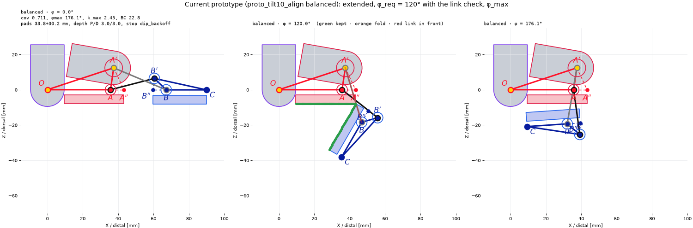

# Current prototype (CoDe)

This is the CoDe finger design currently in CAD. It was logged on 2026-11-05.

*From left to right: extended, at the required flexion of 120° (the pose where coverage is measured), and at φ_max = 176.1°. The middle panel shows the result of the 2026-11-05 link check (`links_block_face`): green points are kept. Both pads are kept in full.*

## Source

| Item | Value |
|---|---|
| Design | `design/output/servo_close/linkage/proto_tilt10_align`, the `balanced` seed (run_004 #2113) |
| Optimizer | smsemoa, seed 0, population 200, 1000 generations |
| Formulation | linkage-v12 |
| Code | `7334085` (2026-11-04, "Search each pad's mounting offset below its link line") |

### Goal it was optimized under

| Item | Value |
|---|---|
| Finger length \|OC\| | 80–90 mm |
| Required flexion φ_req | 120° |
| Segment ratios | \|OA″\| ≥ 0.35, \|B″C\| ≥ 0.25, \|AB\| ≤ 0.35 of \|OC\| |
| Transmission angle | 30–150° |
| PIP servo tilt | fixed at 10° |
| Pad mounting depth | searched, the two pads aligned to one depth (`align_mount_offsets: true`) |
| Pads | at least proximal 20 mm and distal 25 mm long, 5 mm thick |
| Servos (PIP, MCP) | radius 9.5 mm, rear extent 25.5 mm |
| Objectives | transmission, pad_coverage, curl |

## Geometry

All values are in the proximal frame with the finger extended: O is the MCP at the origin, +X points distally and +Z dorsally. They match the CAD variables.

| CAD variable | Value | Note |
|---|---|---|
| A_x, A_z | 35.7, 0 mm | PIP pivot |
| Ap_x, Ap_z (A′) | 37.5, 12.4 mm | PIP servo shaft |
| B (absolute) | 67.2, 0 mm | DIP pivot |
| Bp_x, Bp_z (B′, relative to B) | −6.7, 6.5 mm | absolute (60.5, 6.5) |
| C_x, C_z (C, relative to B) | 22.8, 0 mm | fingertip, BC = 22.8 mm |
| pip_servo_tilt | 10° | |
| A′B | 32.2 mm | coupler |
| AB′ | 25.6 mm | driver link |

Values derived from these:
- \|OC\| = 90.0 mm (the top of its range)
- \|OA\| = 35.7 mm
- \|AB\| = 31.5 mm
- The extended centre of rotation sits at 0.612 of \|OC\|.

### Pads

| | Proximal pad | Distal pad |
|---|---|---|
| Span (along its link line) | x = 9.5 → A″ = 43.3 mm (A″ is 5.8 mm past A′_x) | B″ = 7.4 mm behind B → C (B″ is 0.7 mm short of B′_x) |
| Mounted length | 33.8 mm | 30.2 mm |
| Mounting depth below the line | 3.0 mm | 3.0 mm |
| Contact face depth (mounting + thickness) | 8.0 mm | 8.0 mm |

## Performance

| Item | Value |
|---|---|
| k_max (PIP servo torque per distal moment, 0–120°) | 2.449 (k_min 2.319) |
| Coverage | 0.711 (effective 33.8 + 30.2 mm, both pads usable in full) |
| φ_max | 176.1° (limited by DIP back-off) |
| Servo travel to 120° | 50.4° |
| Least pad clearance | 0.25 mm |
| Least transmission margin | 50.6° (toggle margin 15.3°) |
| Driver link to servo clearance | 1.9 mm |
| Fingertip at 120° | C_x = 35.4 mm, far in front of the MCP |

## Under the current rules (2026-11-05)

The prototype was optimized under linkage-v12. We re-evaluated it with the rules added since then.

- **Link rule** (`goal.loss.links_block_face`): neither crossing link passes in front of either contact face at 120°.
  - The coupler A′B runs outside A″ and comes down the back of the distal pad to B.
  - The driver link A-B′ runs past the end of the proximal pad to B′.
  - So no length is lost: the usable lengths stay 33.8 + 30.2 mm and coverage stays 0.711.
- **`pad_waste_mm` constraint removed**: the prototype has no pad length beyond what it can use, so the change does not affect it.
- **Mounting depth policy**: the prototype searched its depth (range 0–10 mm) and aligned the two pads, so it does not follow the study's `shallowest_supported` policy. The distal pad runs under B, and the depth found, 3.0 mm, equals the radius of B's pin housing.

What these results show: B sits 22.8 mm back from C, and both links pass behind the pads. The link rule demands exactly this shape. The study's earlier CoDe designs with B on C (BC 0.1 mm) do not have it, and neither do the balanced designs of the 2026-11-04 production search, which used |OC| 90–100 mm and 150°.
