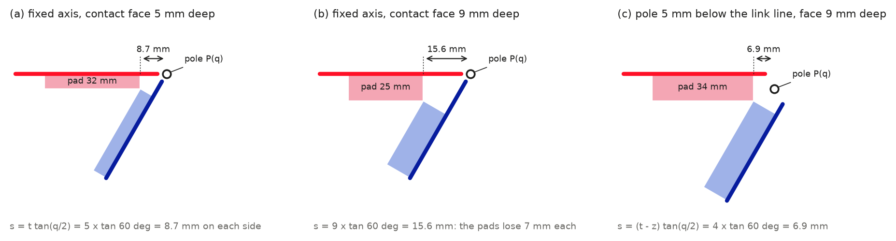

# Study 0: 수학 정리

작성: 2026-11-20. 정의의 기준 문서는 `design/SSoT/problem_formulation.md` A.6.0이다. 이 문서는 그 절의 명제를 증명과 함께 정리한다. 최적화 결과와의 대조는 `report/study2/pole_law.md`에 있고, 끝의 5절에 요약만 둔다.

## 1. 설정

**좌표.** Proximal phalanx에 고정한 평면 좌표를 쓴다. $x$는 link 선을 따라 손끝 쪽, $z$는 dorsal 쪽이 양수이다. Link 선은 기준 자세($q=0$)에서 관절 축들을 잇는 직선 $z=0$이다.

**굽힘.** Flexion $q\in(0,\pi]$에서 distal phalanx는 palmar 쪽으로 $q$만큼 돈다. 회전 행렬을

$$
R_q=\begin{pmatrix}\cos q&\sin q\\-\sin q&\cos q\end{pmatrix}
$$

로 쓴다(시계 방향). Distal phalanx 위의 점 $\mathbf y$의 기준 자세에서의 위치를 $\mathbf y_0$라 하면 $\mathbf y(q)=R_q\,\mathbf y_0+\mathbf b(q)$이다. $\mathbf b(q)$는 구조가 정한다.

**Pad.** Pad $i$($i=1$ proximal, $i=2$ distal)는 자기 phalanx에 고정된 직사각형이다. 장착 깊이 $d_i$는 link 선에서 pad 윗면까지, 두께는 $h_i$, contact face(아랫면)의 깊이는 $t_i=d_i+h_i$이다. 기준 자세에서 proximal pad는 $x\in[x_0,\,x_{1e}]$, distal pad는 $x\in[x_{2s},\,L_f]$를 차지한다.

**관절 간격.** $G=x_{2s}-x_{1e}$. 따라서

$$
\frac{\ell_1+\ell_2}{L_f}=1-\frac{x_0+G}{L_f}. \tag{1}
$$

**가정.** (A1) 평면 운동. (A2) Pad는 강체 직사각형이고 contact face는 link 선에 평행하다. (A3) 두 pad는 서로만 피하면 된다(다른 부품과의 충돌은 $d_i$에 반영된다). (A4) Distal phalanx의 방향은 어느 구조에서나 $q$이다.

## 2. Pole

**보조정리 1 (pole).** $q\in(0,2\pi)$이면 변위 $\mathbf y_0\mapsto R_q\mathbf y_0+\mathbf b$는 한 점 $\mathbf P$를 중심으로 한 회전 $\mathbf y_0\mapsto\mathbf P+R_q(\mathbf y_0-\mathbf P)$와 같고,

$$
\mathbf P(q)=(I-R_q)^{-1}\mathbf b(q)=\tfrac12\Big(\mathbf b-\cot\tfrac q2\,J\,\mathbf b\Big),\qquad J=\begin{pmatrix}0&-1\\1&0\end{pmatrix}. \tag{2}
$$

*증명.* $\det(I-R_q)=2(1-\cos q)=4\sin^2\frac q2>0$이므로 고정점 방정식 $\mathbf P=R_q\mathbf P+\mathbf b$의 해가 유일하다. $(I-R_q)^{-1}=\frac12(I-\cot\frac q2\,J)$는 직접 곱해 확인한다. $\square$

손끝의 경로 $\mathbf r_C(q)$만 알면 $\mathbf b(q)=\mathbf r_C(q)-R_q\,\mathbf r_C(0)$이므로, pole은 구조의 종류와 무관하게 같은 식으로 계산된다. Pole이 link 선 아래로 내려온 깊이를 $z(q)=-P_z(q)$라 쓴다. Pole에서 본 contact face의 깊이는

$$
\tau_i(q)=t_i-z(q)=d_i+h_i-z(q).
$$

**보조정리 2 (pole보다 아래만 다가온다).** $\mathbf u=\mathbf y_0-\mathbf P$라 하면, 굽히는 방향으로의 순간 속도의 $x$ 성분은 $u_z$에 비례한다. 곧 pole보다 dorsal 쪽($u_z>0$)의 점은 손끝 쪽으로, palmar 쪽($u_z<0$)의 점은 proximal 쪽으로 움직인다.

*증명.* $\frac{d}{dq}R_q\mathbf u\big|_{q=0}=-J\mathbf u=(u_z,\,-u_x)$. $\square$

## 3. 명제

### 명제 1. 두 pad가 만나지 않을 조건

대칭인 경우를 먼저 본다: $\tau_1=\tau_2=\tau>0$이고, 두 pad의 관절 쪽 아래 모서리가 pole에서 $x$ 방향으로 같은 거리 $s>0$에 있다.

$$
\boxed{\;\text{flexion }q\text{에서 두 pad가 겹치지 않는다}\iff s\ \ge\ \tau\tan\frac q2\;} \tag{3}
$$

*증명.* Pole을 원점으로 둔다. Proximal pad는 $\{(-s-\lambda,\,-\tau+\mu):\lambda\ge0,\ 0\le\mu\le h\}$이고, 기준 자세의 distal pad는 그것을 $x\mapsto-x$로 뒤집은 것이다. $R_q$로 돌린 distal pad는 proximal pad를 직선 $m_q=\{\mathbf u:\mathbf n\cdot\mathbf u=0\}$, $\mathbf n=(\cos\frac q2,\,-\sin\frac q2)$에 대해 반사한 것과 같다($x$축 반사 뒤 $q$ 회전은 $m_q$에 대한 반사이다). 서로 거울상인 두 볼록 집합은 한쪽이 닫힌 반평면 $\mathbf n\cdot\mathbf u\le0$ 안에 있을 때에만 내부가 겹치지 않는다. Proximal pad 위에서

$$
\mathbf n\cdot\mathbf u=-(s+\lambda)\cos\tfrac q2+(\tau-\mu)\sin\tfrac q2
$$

는 $q\in(0,\pi]$에서 $\lambda=\mu=0$, 곧 관절 쪽 아래 모서리에서 최대이다. 따라서 조건은 $-s\cos\frac q2+\tau\sin\frac q2\le0$이다. $\square$

$\tau\le0$이면 (3)은 모든 $s\ge0$에서 성립한다. Pole이 contact face보다 아래에 있으면 두 pad는 그 자세에서 만나지 않는다.

**관절 간격.** $[0,q_{\mathrm{req}}]$의 모든 자세에서 (3)이 성립해야 하므로

$$
\boxed{\;G(h,q_{\mathrm{req}})=\max_{0<q\le q_{\mathrm{req}}}\ 2\,\big[d+h-z(q)\big]_+\tan\frac q2\;} \tag{4}
$$

이다. 최댓값을 주는 $q$를 임계 flexion $q^\ast$라 한다.

**대칭이 아닌 경우.** 깊이가 다르거나($\tau_1\ne\tau_2$) 두 모서리가 pole에서 다른 거리에 있으면, 모서리의 방향각 $\beta_i=\arctan(\tau_i/s_i)$로 쓴 조건 $\beta_1+\beta_2\le\pi-q$는 두 모서리가 pole에서 같은 거리에 있을 때에만 정확하다. 거리가 다르면 모서리가 상대 pad의 면에 닿으며, 이 문서는 그 경우의 닫힌 식을 주지 않는다. 대조에서는 두 직사각형의 겹침을 직접 계산한다. Pole의 $x$ 좌표가 굽히는 동안 움직이는 경우도 같다. (4)는 pole이 두 모서리의 가운데에 머무는 경우의 값이다.

**따름정리 1.1 (두께에 대한 볼록성).** $z(q)$와 $d$가 고정이면 $G$는 $h$에 대해 볼록하고 구간별로 선형이며, 기울기는 $2\tan(q^\ast/2)\le2\tan(q_{\mathrm{req}}/2)$이다.

*증명.* (4)는 $h$에 대한 아핀 함수 $2(d+h-z(q))\tan\frac q2$들과 0의 최댓값이다. $\square$

### 명제 2. 원기둥 기준 coverage

A.5.1의 정의: 자세 $q$에서 두 contact face의 연장선이 만나는 점을 $X$라 하고, pad $i$가 $X$로부터 덮는 거리의 집합을 $T_i$라 하면 $C_{\mathrm{pad}}(q)=2\,|T_1\cap T_2|/L_f(q)$, $L_f(q)=L_1+L_{vp}(q)+L_2$이다. $L_{vp}$는 두 phalanx 구조의 끝 사이의 직선 거리이다.

대칭인 경우($\tau_1=\tau_2=\tau$, $s_1=s_2=s=G/2$, $\ell_1=\ell_2=\ell$)이고 phalanx 구조의 끝이 link 선 위에서 pad의 관절 쪽 끝과 같은 $x$에 있으면

$$
\boxed{\;C_{\mathrm{pad}}(q)=\frac{L_f-x_0-G}{\,L_f-G\,(1-\cos\frac q2)+2\,z(q)\sin\frac q2\,}\;} \tag{5}
$$

*증명.* Pole을 원점으로 둔다. Proximal face의 직선은 $z=-\tau$이고 distal face의 직선은 그 거울상이므로 둘은 $m_q$ 위에서 만난다: $X=(-\tau\tan\frac q2,\,-\tau)$. $X$에서 proximal pad의 관절 쪽 끝까지의 거리는 $a=s-\tau\tan\frac q2\ge0$(명제 1)이므로 $T_1=[a,\,a+\ell]$이고, 대칭에 의해 $T_2=T_1$이다. 따라서 $|T_1\cap T_2|=\ell$. 두 구조의 끝은 pole에서 본 $\mathbf u_1=(-s,\,z)$와 그 거울상이므로 $L_{vp}=2\,|\mathbf n\cdot\mathbf u_1|=2\,(s\cos\frac q2+z\sin\frac q2)$. $L_1+L_2=x_0+2\ell=L_f-G$를 대입한다. $\square$

분모의 둘째 항은 관절 간격이 굽히면 짧아지는 것이고, 셋째 항은 pole이 link 선 아래에 있으면 두 구조의 끝이 벌어지는 것이다. $\bar C_{\mathrm{pad}}$는 (5)를 $q\in\{90^\circ,\ (90^\circ+q_{\mathrm{req}})/2,\ q_{\mathrm{req}}\}$에서 평균한 값이다.

**따름정리 2.1 (pole을 내리면 항상 이득이다).** Pole의 깊이가 상수 $z<t$이고 $G=2(t-z)\tan\frac{q_{\mathrm{req}}}2$인 관절에서, $z$를 늘리면 $C_{\mathrm{pad}}(q)$는 $q\le q_{\mathrm{req}}$의 모든 평가 자세에서 커진다.

*증명.* $T=\tan\frac{q_{\mathrm{req}}}2$라 하자. (5)의 분자 $N$과 분모 $D$에 대해 $\partial N/\partial z=2T$, $\partial D/\partial z=2T(1-\cos\frac q2)+2\sin\frac q2$이다. $q=q_{\mathrm{req}}$에서 $2T(1-\cos\frac q2)+2\sin\frac q2=2T$이므로 $\partial_z(N/D)=2T\,(D-N)/D^2>0$이다($D>N$). $q<q_{\mathrm{req}}$에서는 $\partial D/\partial z<2T$이므로 더 크다. $\square$

이득은 $z=t$까지 이어지고 그때 $G=0$이다. 이 모델에서 가장 좋은 관절은 contact face 위의 점을 중심으로 도는 관절이다.

### 명제 3. 접촉면에서 본 운동

Proximal contact face의 직선을 기준으로 본 pole의 위치를 $\mathbf p(q)$, distal contact face 위의 한 점의 기준 자세 위치를 $\mathbf c_0$라 하면 $\mathbf c(q)=\mathbf p(q)+R_q(\mathbf c_0-\mathbf p(q))$이다. 같은 $\mathbf c_0$를 가진 두 손가락에서 pole이 $\Delta\mathbf p(q)$만큼 다르면

$$
\boxed{\;\|\Delta\mathbf c(q)\|=2\sin\frac q2\,\|\Delta\mathbf p(q)\|\;} \tag{6}
$$

*증명.* $\Delta\mathbf c=(I-R_q)\Delta\mathbf p$이고, $(I-R_q)^{\!\top}(I-R_q)=2(1-\cos q)\,I=4\sin^2\frac q2\,I$이다. $\square$

**따름정리 3.1.** 접촉면에서 본 운동이 같을 필요충분조건은 $\mathbf p(q)$가 같은 것, 곧 pole이 contact face에 대해 같은 자리에 있는 것이다.

**따름정리 3.2 (지키는 조건은 하나이다).** $\tau(q)$가 같으면 (4)에 의해 $G$도 같다. 접촉면에서 본 운동을 유지하는 다시 설계는 pad 길이도 유지한다.

## 4. 구조별 결과

### 4.1 고정 축 (2R-DD, 2R-remote)

Pole은 관절 축이다: $z\equiv0$. $\tau=d+h$가 $q$와 무관하므로 $q^\ast=q_{\mathrm{req}}$이고

$$
G=2\,(d+h)\tan\frac{q_{\mathrm{req}}}2,\qquad
\frac{\partial G}{\partial h}=2\tan\frac{q_{\mathrm{req}}}2,\qquad
\frac{\partial G}{\partial q_{\mathrm{req}}}=(d+h)\sec^2\frac{q_{\mathrm{req}}}2. \tag{7}
$$

| $q_{\mathrm{req}}$ | $90^\circ$ | $120^\circ$ | $150^\circ$ |
|---|---|---|---|
| 두께 1 mm당 $G$의 증가 | 2.00 mm | 3.46 mm | 7.46 mm |

**접촉면에서 본 운동의 하한.** Pad가 $\Delta h$ 두꺼워지고 장착 깊이를 $\Delta d\ge0$만큼 줄이면, contact face는 축에서 $\Delta h-\Delta d$만큼 멀어진다. 축은 다시 설계해도 link 선 위에 있으므로 (6)에서

$$
\max_{q\le q_{\mathrm{req}}}\|\Delta\mathbf c(q)\|=2\sin\frac{q_{\mathrm{req}}}2\,(\Delta h-\Delta d). \tag{8}
$$

이 값은 설계에 무관하다. $d=0$인 2R-remote는 $\Delta d=0$이다.

### 4.2 구름 접촉 (RCJ)

반지름 $r$의 같은 roller 둘이 미끄럼 없이 구른다. Proximal roller의 중심을 $(a,0)$이라 하자.

$$
\mathbf P(q)=\big(a+r,\ -r\tan\tfrac q4\big),\qquad z(q)=r\tan\frac q4. \tag{9}
$$

*증명.* 같은 반지름의 구름에서 distal phalanx는 proximal phalanx를 두 roller의 공통 접선 $m$에 대해 반사한 것이다. 기준 자세의 접선은 $m_0:x=a+r$이고, flexion $q$에서 접점은 $(a,0)+r(\cos\frac q2,-\sin\frac q2)$, 접선은 $m_q:\mathbf n\cdot(\mathbf y-(a,0))=r$이다. 변위는 $m_0$ 반사 뒤 $m_q$ 반사이므로 두 직선의 교점을 중심으로 한 회전이다. $x=a+r$을 $m_q$에 넣으면 $r\cos\frac q2-z'\sin\frac q2=r$에서 $z'=-r\,(1-\cos\frac q2)/\sin\frac q2=-r\tan\frac q4$. $\square$

(4)에 넣으면, $\tan\frac q4\tan\frac q2=\sec\frac q2-1$이므로

$$
G=2\Big[(d+h)\tan\frac{q_{\mathrm{req}}}2-r\Big(\sec\frac{q_{\mathrm{req}}}2-1\Big)\Big] \tag{10}
$$

이다($d+h\ge r\tan\frac{q}{4}$인 범위에서 괄호 안이 $q$에 대해 증가하므로 $q^\ast=q_{\mathrm{req}}$). 두께에 대한 기울기는 고정 축과 같은 $2\tan(q_{\mathrm{req}}/2)$이다. $r$이 관절 actuator로 정해져 있으면 접촉면에서 본 운동의 하한도 (8)과 같다.

### 4.3 Crossed four-bar (CFL)

Proximal phalanx의 pivot $A$, $A'$과 distal phalanx의 pivot $B$, $B'$을 link $AB'$과 $A'B$가 잇는다. 순간 회전 중심은 두 link의 연장선의 교점이다(Aronhold–Kennedy). $A$, $B$가 link 선 위에 있고 $A'$, $B'$이 dorsal 쪽에 있으면 기준 자세의 교점은 dorsal 쪽에 있고($z(0^+)<0$), 굽히면서 palmar 쪽으로 내려온다.

Pole $\mathbf P(q)$는 (2)로 계산한다. $B$는 중심 $A'$, 반지름 $|A'B|$의 원과 중심 $A-R_q(B'_0-B_0)$, 반지름 $|AB'|$의 원의 교점이다. 이 문서는 $z(q)$를 linkage 치수의 닫힌 식으로 쓰지 않으며, $z(q)$를 얼마나 내릴 수 있는지의 한계도 주지 않는다.

$z(q)$가 $q$에 따라 커지면 $\tau(q)\tan\frac q2$는 구간 안쪽에서 최대가 될 수 있다($q^\ast<q_{\mathrm{req}}$). 그때 $\partial G/\partial q_{\mathrm{req}}=0$이다. 고정 축에서는 (7)에 의해 항상 양수이다.

### 4.4 요약

| | $z(q)$ | $q^\ast$ | $\partial G/\partial h$ (다시 설계할 때) | 접촉면에서 본 운동 (pad가 $\Delta h$ 두꺼워질 때) |
|---|---|---|---|---|
| 고정 축 | $0$ | $q_{\mathrm{req}}$ | $2\tan(q_{\mathrm{req}}/2)$, 피할 수 없음 | 하한 (8) |
| 구름 접촉, $r$ 고정 | $r\tan(q/4)$ | $q_{\mathrm{req}}$ | $2\tan(q_{\mathrm{req}}/2)$ | 하한 (8) |
| Crossed four-bar | Linkage가 정함 | 구간 안쪽일 수 있음 | $z$를 $\Delta h$만큼 내리면 0 | $z$를 $\Delta h$만큼 내리면 0 (따름정리 3.2) |

## 5. 예측과 대조

Study 1과 Study 2가 확인하는 예측(SSoT A.6.0)과, 2026-11-20 시점에 끝난 Study 1 설계 32개(72개 조건 중)로 본 결과이다.

| 예측 | 대조 | 결과 |
|---|---|---|
| P1. 최적 설계의 $G$는 명제 1의 값이다 | 직사각형의 겹침을 직접 계산한 최소 간격 대 설계의 간격 | 32개 중 30개에서 0.2 mm 이내, 최대 0.7 mm |
| P2. 최적 설계의 $\bar C_{\mathrm{pad}}$는 명제 2의 값이다 | 비대칭까지 그대로 계산한 값 대 평가기의 값 | 고정 축과 구름 접촉은 $10^{-4}$ 미만, CFL은 0.0045 이하 |
| P3. 고정 축은 (7)을 따른다. Pole이 내려가는 구조는 $q^\ast<q_{\mathrm{req}}$ | 2R-remote의 $G$; CFL의 $q^\ast$ | 2R-remote 3→5 mm: 식 6.9 mm, 설계 7.0 mm. CFL의 $q^\ast$는 87–105° |
| 고정한 손가락의 예측 | 다른 두께의 pad를 단 99개 경우의 첫 접촉 각도 대 평가기의 $q_{\max}$ | $-0.25^\circ$에서 $+2.1^\circ$ (평가기 격자 1°) |
| P4. (8)과 따름정리 3.2 | Study 1의 이웃한 두께의 설계끼리, $q_{\mathrm{req}}=120^\circ$ | 2R-remote 3.46, 3.47 mm (하한 3.46). CFL 0.84, 2.26, 0.48 mm이고 그때 $G$의 변화는 +0.5, +3.7, −0.2 mm |
| (9) | CFL의 pole을 독립 구현으로 다시 계산; roller의 닫힌 식 대 수치 | 0.13 mm 이하; 단위 테스트 통과 |

## 6. 이 정리가 말하지 않는 것

- CFL이 $z(q)$를 얼마나 내릴 수 있는지. Transmission angle, pivot의 크기, actuator의 자리가 제한하지만 식으로 쓰지 않았다.
- 장착 깊이 $d$가 어떻게 정해지는지. 2R-DD와 RCJ에서는 pad를 관절 hardware 밑으로 얼마나 넣는지의 절충이며, 지금은 최적화 결과에서 읽는다.
- 대칭이 아닌 경우의 닫힌 식(3.1의 단서).
- 가림, mechanical advantage, 3차원 형상, pad의 변형.
