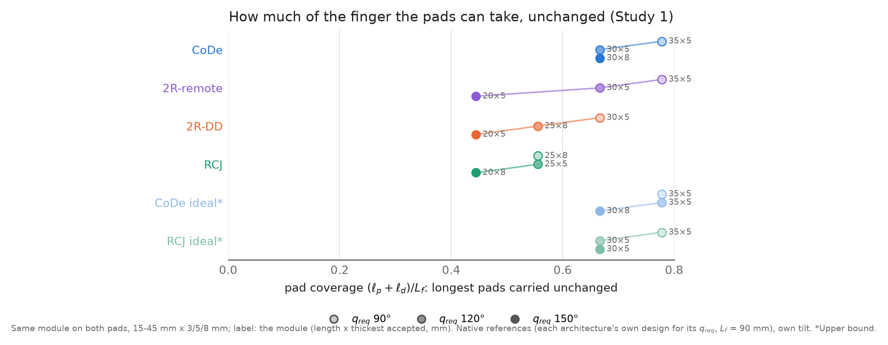

# Study 1: fixed morphology, native references (2026-11-20)

**Track: study** (`design/scripts/study/`). Formulation: `design/SSoT/problem_formulation.md` A.6.1–A.6.2.

목적함수는 원기둥 coverage $\bar C_{\mathrm{pad}}$ 입니다. 이 report의 그림과 표는 직관적인 비교를 위해
**pad coverage** $(\ell_p+\ell_d)/L_f$ (펴진 손가락 길이 중 pad가 차지하는 비율)로 보여 줍니다.

## Setup

| Item | Value |
|---|---|
| References | `references_native.yaml`: 6 architectures × $q_{\mathrm{req}}\in\{90,120,150\}$ = 18 native designs |
| Native search | `scripts/study/<f>.yaml` + `base.yaml`, preset `search` (GA + NSGA-II, seeds 0–2), objective $\bar C_{\mathrm{pad}}$ only, $MA_{\min}$ null, $L_f\in[89.95, 90.05]$ mm, tilt $\in[0^\circ,45^\circ]$ (CoDe ideal 15° fixed) |
| Evaluation | each reference at its own $q_{\mathrm{req}}$ only |
| Modules | 71 pairs (`modules.yaml`): combined / proximal-only / distal-only, 15–45 mm × 3/5/8 mm, each 21; named 8 |
| Tilt sweep | 12 physical references (CoDe, 2R-remote, 2R-DD, RCJ) held at 0/15/30/45°, rest of the design unchanged |
| Output | `design/output/study/study1_fixed_morphology_native/assembly_results.csv` (4686 assemblies, 66 references) |

Native search 로그: 18 runs, 2026-11-19 21:11 – 2026-11-20 02:02.

## Native designs (balanced seed)

목적이 하나라 representative seed는 `most_coverage;balanced` 하나입니다.

| $q_{\mathrm{req}}$ | Architecture | proximal + distal pad (mm) | pad coverage | $\bar C_{\mathrm{pad}}$ | $q_{\max}$ | $MA_{wc}$ | tilt | stop | pad clearance (mm) | bound hits |
|---|---|---|---|---|---|---|---|---|---|---|
| 90° | CoDe | 36.2 + 36.2 | 0.804 | 0.793 | 114.4° | 0.41 | 40° | transmission | 0.01 | proximal_mount_offset low |
| | CoDe ideal* | 36.6 + 36.6 | 0.813 | 0.794 | 116.8° | 0.29 | 15° | transmission | 0.02 | proximal_mount_offset low |
| | 2R-remote | 35.3 + 35.2 | 0.783 | 0.809 | 90.0° | 1.00 | 32° | collision | 0.00 | drops low |
| | 2R-DD | 31.2 + 31.2 | 0.693 | 0.726 | 90.0° | 1.00 | **45°** | collision | 0.00 | tilt high |
| | RCJ | 29.6 + 29.7 | 0.659 | 0.663 | 90.3° | 0.50 | 15° | collision | 0.05 | roller_radius low |
| | RCJ ideal* | 35.0 + 35.0 | 0.778 | 0.787 | 90.8° | 0.50 | 0° | collision | 0.06 | roller_radius low |
| 120° | CoDe | 33.3 + 33.4 | 0.741 | 0.748 | 180° | 0.55 | **45°** | curl | 0.00 | tilt high |
| | CoDe ideal* | 36.2 + 35.4 | 0.796 | 0.765 | 151.4° | 0.31 | 15° | transmission | 0.03 | proximal_mount_offset low |
| | 2R-remote | 31.6 + 31.5 | 0.701 | 0.758 | 120.2° | 1.00 | 11° | collision | 0.04 | drops low |
| | 2R-DD | 28.8 + 29.0 | 0.642 | 0.700 | 120.1° | 1.00 | **45°** | collision | 0.03 | tilt high |
| | RCJ | 26.4 + 26.3 | 0.586 | 0.608 | 120.1° | 0.50 | 22° | collision | 0.02 | roller_radius low |
| | RCJ ideal* | 34.3 + 34.2 | 0.761 | 0.781 | 123.9° | 0.50 | 0° | collision | 0.34 | roller_radius, drops low |
| 150° | CoDe | 34.6 + 34.6 | **0.769** | 0.736 | 180° | 0.45 | 40° | curl | 0.01 | – |
| | CoDe ideal* | 35.2 + 34.9 | 0.779 | 0.736 | 180° | 0.60 | 15° | curl | 0.00 | – |
| | 2R-remote | 21.6 + 25.0 | 0.518 | 0.593 | 150.1° | 1.00 | 27° | collision | 0.02 | drops low |
| | 2R-DD | 21.6 + 25.0 | 0.518 | 0.593 | 150.1° | 1.00 | 44° | collision | 0.02 | drops low |
| | RCJ | 23.3 + 25.0 | 0.537 | 0.560 | 150.1° | 0.50 | 44° | collision | 0.01 | roller_radius low |
| | RCJ ideal* | 32.5 + 32.4 | 0.721 | 0.755 | 150.1° | 0.50 | 0° | collision | 0.01 | drops low |

\* 이상화 상한 (joint servo 없음).

- 실제 구조 중 pad coverage는 **CoDe가 세 $q_{\mathrm{req}}$ 모두 1위**입니다 (0.804 / 0.741 / 0.769). 원기둥
  $\bar C_{\mathrm{pad}}$로는 90°·120°에서 2R-remote가 CoDe보다 약간 높습니다: 고정 관절은 pad가 짧아도 굽힌
  자세에서 잘 마주 보기 때문입니다.
- 150°에서 2R과 RCJ는 pad가 급격히 줄고 distal pad가 최소 지지 길이 25 mm에 붙습니다. CoDe는 거의 줄지 않습니다
  (moving ICR 덕에 $q_{\max}$=180°까지 curl).
- 150°의 2R-DD와 2R-remote는 같은 설계에 수렴했습니다 (pad 충돌이 지배, servo는 묶이지 않음).
- CoDe(120°)와 2R-DD(90°, 120°)는 tilt가 상한 45°에 붙었습니다. tilt 범위를 넓히면 조금 더 나올 수 있습니다.

## Acceptance (각 reference 자기 tilt)

각 칸: 받아들인 module 수 (combined / proximal / distal, 각 21개 중), 그리고 양쪽 pad에 같은 module을 달 때
받아들인 최대 pad coverage (가장 긴 module × 그 길이에서 가장 두꺼운 것).

| Architecture | 90° | 120° | 150° |
|---|---|---|---|
| CoDe | 14/15/15 · **0.78** (35×5) | 11/12/12 · **0.67** (30×5) | 12/12/12 · **0.67** (30×8) |
| 2R-remote | 14/15/15 · **0.78** (35×5) | 11/12/12 · **0.67** (30×5) | 4/6/8 · 0.44 (20×5) |
| 2R-DD | 11/12/12 · 0.67 (30×5) | 9/9/9 · 0.56 (25×8) | 4/6/8 · 0.44 (20×5) |
| RCJ | 9/9/9 · 0.56 (25×8) | 8/9/9 · 0.56 (25×5) | 6/6/9 · 0.44 (20×8) |
| CoDe ideal* | 14/15/15 · 0.78 (35×5) | 14/15/15 · 0.78 (35×5) | 12/15/12 · 0.67 (30×8) |
| RCJ ideal* | 14/15/15 · 0.78 (35×5) | 11/12/12 · 0.67 (30×5) | 10/12/12 · 0.67 (30×5) |

- 90°·120°에서 CoDe와 2R-remote는 같고, 150°에서 CoDe만 30 mm module을 유지합니다 (2R 20 mm, RCJ 20 mm).
- 실패 이유는 대부분 장착 단계입니다: module이 phalanx보다 길거나 (`bounds_*_pad_mm`), 2R은 관절 hardware 때문에
  장착 깊이가 없습니다 (`no_depth`, 2R-DD 22개, 2R-remote 14개). 운동 단계 실패(`f_motion_deg`)는 150°의 2R에서
  4개, 나머지는 0–2개입니다.
- 5 mm grid라 30 / 35 mm 경계에서 동률이 많습니다. 차이를 더 보려면 길이 간격을 2.5 mm로 줄여야 합니다.

## Tilt sensitivity (physical references)

받아들인 module 수 (combined + proximal + distal, 63개 중):

| Reference | own | 0° | 15° | 30° | 45° |
|---|---|---|---|---|---|
| CoDe q90 (own 40°) | 44 | 44 | **0** | **0** | 44 |
| CoDe q120 (own 45°) | 35 | **0** | **0** | 35 | 35 |
| CoDe q150 (own 40°) | 36 | **0** | **0** | 36 | 36 |
| 2R-remote q90 / q120 / q150 | 44 / 35 / 18 | 같음 | 같음 | 같음 | 같음 |
| 2R-DD q120 (own 45°) | 27 | 24 | 26 | 11 | 27 |
| 2R-DD q150 (own 44°) | 18 | **0** | 10 | 18 | 18 |
| RCJ q90 / q120 / q150 | 27 / 26 / 21 | 27 / 26 / 20 | 27 / 26 / 20 | 27 / 26 / 21 | 27 / 26 / 21 |

- CoDe가 0이 되는 tilt는 모두 `static_pad_collision_mm`입니다: 이 native 설계를 그대로 두고 servo만 돌리면
  servo 몸체가 pad와 겹칩니다. 다른 tilt는 그 tilt의 native 설계가 아니므로, 0은 "그 tilt가 불가능"이 아니라
  "이 설계에서 servo만 돌리면 안 맞는다"는 뜻입니다.
- 2R-remote와 RCJ는 tilt에 거의 둔감합니다. 2R-DD는 PIP servo가 관절에 있어 tilt에 민감합니다.

## Notes

- Native 설계는 원기둥 $\bar C_{\mathrm{pad}}$를 최대화한 것이므로 pad coverage 최대 설계는 아닙니다.
- 이전 matched run (`study1_fixed_morphology_2026-11-19.md`)과는 reference가 달라 숫자를 직접 비교할 수 없습니다.
- 18 references 모두 `shared.references` 로딩과 `check_comparable` (설계 $q_{\mathrm{req}}$별 그룹)을 통과했습니다.
