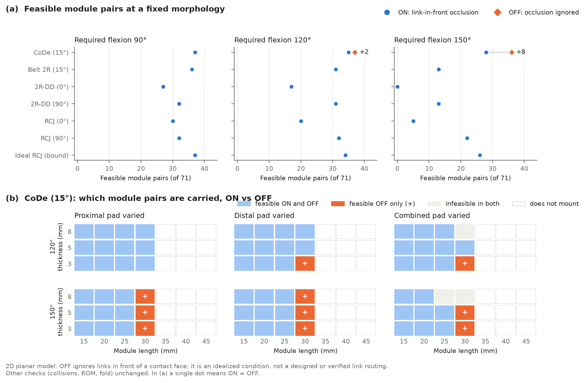

# Sensitivity to the link-in-front occlusion rule (appendix draft)

2026-11-17 · **Study track**. Code `f4c355c` (clean tree). Active Study 1 conditions: `references_nominal15.yaml`,
0–90° tilt sweep, 71 module pairs, required flexion 90/120/150°.

## Question

The study counts part of a contact face as unusable when one of CoDe's crossing links passes in front of it
(`goal.loss.links_block_face`). The belt 2R's belt and pulleys are treated the same way. On real hardware, a link
could be shaped or placed in another Y layer to avoid this. This sensitivity run asks how much the study's
accommodation results depend on that rule. It separates kinematic accommodation from the occlusion assumption.
It does not try to improve CoDe's numbers.

## Conditions

| | ON (the study's rule) | OFF (`config_faceoff.yaml`) |
|---|---|---|
| Link through a pad block | taken as routed around it (`links_clear_pads`) | the same |
| Link in front of a contact face | that part of the face is not usable | ignored |
| Collisions (pad–pad, pins, servos), ROM, fold rule | kept | kept |
| Kinematics and morphology | frozen reference | the same |

Both conditions are geometric modelling assumptions. ON also idealizes routing, because a link that passes
through a pad is assumed to go around it. OFF is an idealized comparison condition: it simply ignores links in
front of a face. It does not design or verify any link shape. The OFF results are therefore not buildable designs.

Runs (`design/output/study/`): `study1_fixed_morphology_tilt_sweep` (ON) and
`study1_fixed_morphology_tilt_sweep_faceoff` (OFF). `faceoff_counts.csv` and `faceoff_changes.csv` are in the
OFF folder.

    python scripts/study/study1_fixed_morphology/run.py
    python scripts/study/study1_fixed_morphology/run.py scripts/study/study1_fixed_morphology/config_faceoff.yaml
    python scripts/study/study1_fixed_morphology/summarize_faceoff.py

## Result: Study 1 at a fixed morphology

Feasible module pairs out of 71, shown as ON → OFF (ΔN):

| Reference | 90° | 120° | 150° |
|---|---|---|---|
| CoDe (15°) | 37 → 37 (0) | 35 → 37 (**+2**) | 28 → 36 (**+8**) |
| Belt 2R (15°) | 36 → 36 (0) | 31 → 31 (0) | 13 → 13 (0) |
| 2R-DD (0°) | 27 → 27 (0) | 17 → 17 (0) | 0 → 0 (0) |
| 2R-DD (90°) | 32 → 32 (0) | 31 → 31 (0) | 13 → 13 (0) |
| RCJ (0°) | 30 → 30 (0) | 20 → 20 (0) | 5 → 5 (0) |
| RCJ (90°) | 32 → 32 (0) | 32 → 32 (0) | 22 → 22 (0) |
| Ideal RCJ (bound) | 37 → 37 (0) | 34 → 34 (0) | 26 → 26 (0) |

- **F_ON ⊆ F_OFF holds for every reference, tilt and flexion.** The geometry is frozen and only the penalty
  changes, so turning the rule off never removes a feasible assembly or shortens a face. The summary script and
  the tests check this.
- **The 2R-DD and the RCJs are unchanged (ΔN = 0).** They have no link or belt in front of a face. ΔN is also the
  same at every servo tilt.
- **The belt 2R's verdicts are also unchanged.** Its pulleys do stand in front of a face in 105 assemblies.
  They hide at most 0.2 mm, which never decides whether a module is carried.
- **CoDe is the only reference that changes, and only at large flexion.** All ten modules it gains are 30 mm
  long:
  - proximal 30 mm × 3/5/8 at 150°;
  - distal 30 mm × 3 at 120° and × 3/5/8 at 150°;
  - combined 30 × 3 at 120° and 150°, and 30 × 5 at 150°.

  With the rule on, the links hide 0.5–1 mm of the proximal face and 1.5–4.5 mm of the distal face at those
  flexions.
- Pads of 35 mm or more do not mount on this morphology on any architecture (support room). So Study 1 cannot
  show the rule's effect on long proximal pads. That effect is in Study 2 (below).

## Supporting evidence: Study 2, which adapts the morphology

The 15° face-off control (`transmission_sensitivity_2026-11-09.md`, transmission angle 30–150°, population
100 × 100 generations, seeds 0–2) pairs with the main ON run of the same budget. Both are reported as
(ε_E, ε_Q), because Study 2 minimizes ε_E first and then ε_Q. ε_Q alone can mislead: OFF may reach a lower ε_E
by taking a larger ε_Q.

| Target (E floor) | ON | OFF |
|---|---|---|
| asym_long_proximal (0.069) | not found (0/3 seeds) | (0.069, 0.022), at the floor, 3/3 seeds |
| asym_proximal_heavy (0.124) | not found (0/3 seeds) | (0.124, 0.021), at the floor, 3/3 seeds |

The historical 10° runs (`study1_study2_2026-11-06.md`) show the same pattern. They also show that OFF is not
lower on every axis: on long_thick OFF took ε_Q 0.310 against 0.059 ON. Those 10° numbers are not used as
15° results.

## Correction made for this run

ON could read a face up to 0.18 mm (CoDe) or 0.25 mm (belt 2R) longer than OFF. The cause was a rounding in how
the kept length re-read the fold limit. This broke F_ON ⊆ F_OFF in 49 belt 2R assemblies. The kept length is now
capped at the fold's own length (commit `9115e3f`).

At the nominal tilt this lowers the belt 2R's ON counts from 37/33/17 to **36/31/13**. Every other study run that
used the rule was made before this fix:
- Studies 1–2 of 2026-11-06;
- interface family;
- ROM-conditioned;
- transmission sensitivity.

Their CoDe and belt 2R ON results carry the old rounding. The error is at most 0.25 mm of usable length, so only
assemblies that were within that margin can change.

## What this supports

> Some of CoDe's proximal-interface accommodation limits arise from the link-in-front occlusion assumption rather
> than from articulation kinematics alone. Removing this penalty enlarges the computationally feasible interface
> set (Study 1 at 150°: 28 → 36 of 71 pairs; Study 2: both long proximal targets reach the E floor). It does not
> establish that the corresponding link routing can be built.

- Main text: report the ON results (conservative) and state that links can occlude contact faces.
- Appendix: this ON/OFF comparison.
- Whether a curved link or a Y-layer route can realize OFF is a separate mechanical design problem that is not
  addressed here.
- Not done: a pose-resolved occlusion ratio r_occ(φ), and a geometry check of individual OFF designs.
