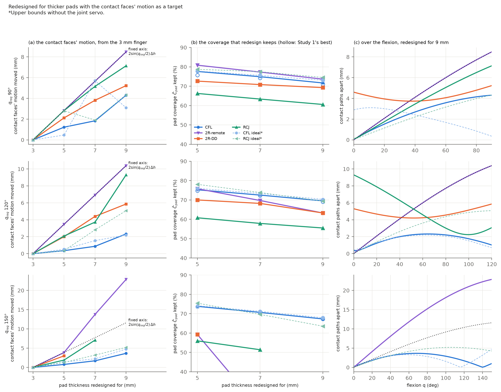

# Study 2: 더 두꺼운 접촉면으로 다시 설계할 때 접촉면의 운동을 지킬 수 있는가

작성: 2026-11-21. 질문: 손가락을 더 두꺼운 contact interface에 맞춰 다시 설계해야 할 때, 접촉면에서 본 운동(contact-centric kinematics)을 얼마나 지킬 수 있는가. coverage도 함께 본다(SSoT A.6.3).

## 방법

| 항목 | 내용 |
|---|---|
| 기준 손가락 | 구조와 q_req마다 Study 1의 3 mm 설계. Study 1은 2026-11-21에 CFL 조건을 이웃 두께에서 다시 탐색했고, 기준은 조건마다 독립 run과 재탐색 중 최선이다 |
| 탐색 | 5/7/9 mm마다 NSGA-II 200 × 200, seed 0–1 |
| 목적 1 | 기준 대비 접촉면 운동의 변화 D_c(distal 접촉면 경로를 proximal 접촉면에서 봄)를 최소화 |
| 목적 2 | 그 두께의 Study 1 목표 아래에서 C̄_pad를 최대화 |
| 하한 | 두지 않음 |
| 비교 기준 | 고정축 관절이 보여야 하는 변화 2 sin(q_req/2)·Δh (Study 0의 P4) |
| 손가락 길이 | L_f = 90 mm |

출력은 `design/output/study/study2_redesign_2026-11-21/`(`summary.csv`, `front.csv`, `profiles.csv`)에 있다. 아래 표는 각 front의 coverage 끝, 곧 가장 높은 C̄_pad의 설계다.

## 결과

아래 표의 칸은 접촉면 운동의 변화 / 다시 설계한 손가락의 C̄_pad (괄호: 이 탐색 시점의 Study 1 최선)이다. Study 1은 이 결과를 받아 한 번 더 탐색했다. 최종 Study 1 값(`report/study1/study1_thickness_coverage.md`)과 아래 C̄_pad의 차이는 CFL에서 0.2 %p, CFL ideal에서 0.5 %p 이내다.

| 구조 | q_req | 3→5 mm | 3→7 mm | 3→9 mm |
|---|---|---|---|---|
| 고정축 기준 | 90° | 2.83 mm | 5.66 mm | 8.49 mm |
| | 120° | 3.46 mm | 6.93 mm | 10.39 mm |
| | 150° | 3.86 mm | 7.73 mm | 11.59 mm |
| **CFL** | 90° | **1.22 mm** / 0.776 (0.757) | **1.84 mm** / 0.749 (0.742) | **4.31 mm** / 0.717 (0.711) |
| | 120° | **0.35 mm** / 0.753 (0.748) | **0.86 mm** / 0.725 (0.723) | **2.32 mm** / 0.695 (0.691) |
| | 150° | **0.77 mm** / 0.738 (0.736) | **1.71 mm** / 0.707 (0.705) | **3.65 mm** / 0.673 (0.673) |
| 2R-remote | 90° | 2.83 mm / 0.809 | 5.66 mm / 0.773 | 8.49 mm / 0.736 |
| | 120° | 3.46 mm / 0.758 | 6.93 mm / 0.697 | 10.39 mm / 0.633 |
| | 150° | 3.86 mm / 0.593 | 13.77 mm / 0.209 | 22.86 mm / 0.000 |
| 2R-DD | 90° | 2.12 mm / 0.726 | 3.82 mm / 0.708 | 5.23 mm / 0.693 |
| | 120° | 2.00 mm / 0.700 | 4.40 mm / 0.682 | 5.86 mm / 0.633 |
| | 150° | 3.00 mm / 0.593 | 설계 없음 | 설계 없음 |
| RCJ | 90° | 2.83 mm / 0.663 | 5.16 mm / 0.634 | 7.14 mm / 0.606 |
| | 120° | 2.08 mm / 0.608 | 3.72 mm / 0.579 | 9.30 mm / 0.555 |
| | 150° | 1.90 mm / 0.560 | 7.10 mm / 0.514 | 설계 없음 |
| CFL ideal* | 90° | 0.46 mm / 0.779 | 5.70 mm / 0.756 | 3.10 mm / 0.731 |
| | 120° | 0.52 mm / 0.760 | 1.54 mm / 0.733 | 2.20 mm / 0.703 |
| | 150° | 1.40 mm / 0.741 | 2.23 mm / 0.712 | 4.76 mm / 0.679 |
| RCJ ideal* | 90° | 2.80 mm / 0.787 | 1.91 mm / 0.775 | 4.33 mm / 0.745 |
| | 120° | 0.35 mm / 0.781 | 2.81 mm / 0.738 | 5.07 mm / 0.694 |
| | 150° | 1.28 mm / 0.755 | 3.20 mm / 0.696 | 5.20 mm / 0.636 |

2R, RCJ와 ideal 구조의 C̄_pad는 모두 Study 1의 최선과 같다(괄호 생략).

## 읽는 법

1. **CFL은 다시 설계해도 접촉면의 운동을 가장 적게 바꾼다.** 이것은 q_req 셋과 두께 셋 모두에서 실제 구조 넷 가운데 성립한다.
   - 변화는 0.35–4.31 mm로, 고정축 기준의 10–51%다(q120에서 10–22%, q150에서 20–31%, q90에서 32–51%).
   - 이 차이는 coverage를 내주고 얻은 것이 아니다. 같은 설계의 C̄_pad가 최종 Study 1 최선과 0.2 %p 이내다.
2. **2R-remote의 변화는 정확히 고정축 기준이다**(q90, q120). 관절이 pad 두께와 함께 움직일 수 없으므로 Study 0의 하한에 그대로 걸린다. q150의 7/9 mm에서는 기준보다 크다. 그 설계들은 접촉하지 못하는 퇴화한 설계다(C̄_pad 0.209, 0).
3. **2R-DD와 RCJ는 기준 아래로 내려갈 때가 있지만 CFL보다 크다.** 2R-DD는 관절 위치를 x로 옮길 수 있어서, RCJ는 pole이 굴러서다. 두꺼운 쪽에서는 RCJ도 기준에 가깝다(q120 9 mm 9.30 mm).
4. **두께가 커질수록 변화가 커진다.** CFL도 9 mm에서는 2.3–4.3 mm다. 접촉면을 완전히 지키지는 못하고, 고정축보다 2–10배 적게 바꾼다.
5. **ideal 구조(servo 몸체 없음)는 상한으로 따로 읽는다.** CFL ideal q90 7 mm(5.70 mm)는 coverage 끝의 설계가 크게 바뀐 경우다. front의 다른 점에서는 0.65 mm 이하로 바꾼 설계가 있다(`summary.csv`의 least_change).

## 덧붙임: Study 1과의 관계

이 탐색의 시점에는 CFL q90 5 mm에서 Study 1보다 1.9 %p 높은 설계가 나왔다(0.776 대 0.757). 원인은 두 가지였다.

- Study 1이 5 mm 재탐색 결과를 읽지 못한 폴더 이름 오류.
- Study 1 탐색의 부족.

둘을 고치고 Study 2의 설계에서 Study 1을 한 번 더 탐색했다. 이제 Study 1의 모든 CFL 칸이 이 front의 최선 이상이다(q90 5 mm 0.778). 위 결론, 곧 접촉면 운동의 변화와 그 coverage는 기준 손가락(3 mm)이 바뀌지 않았으므로 그대로다.
