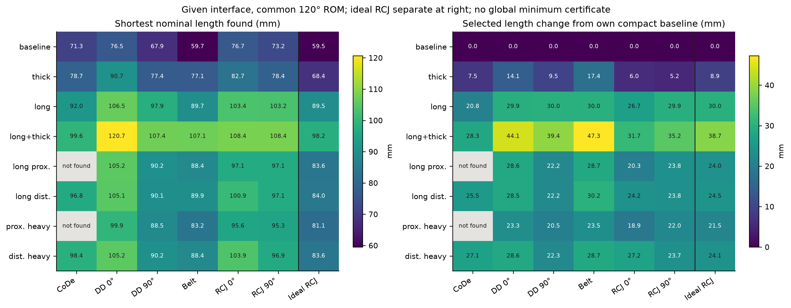
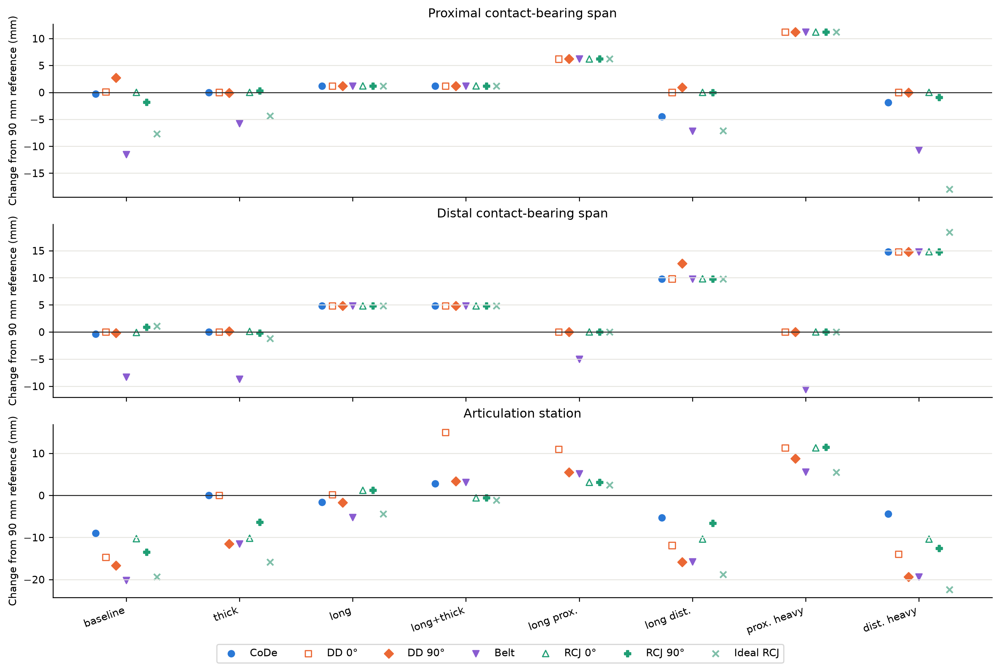
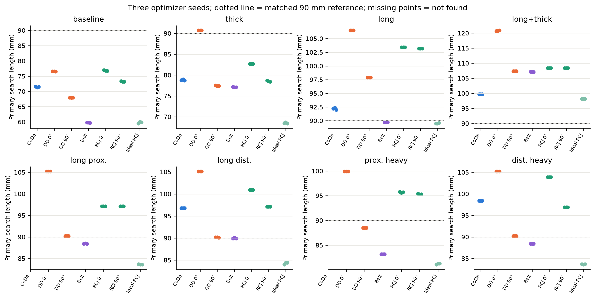
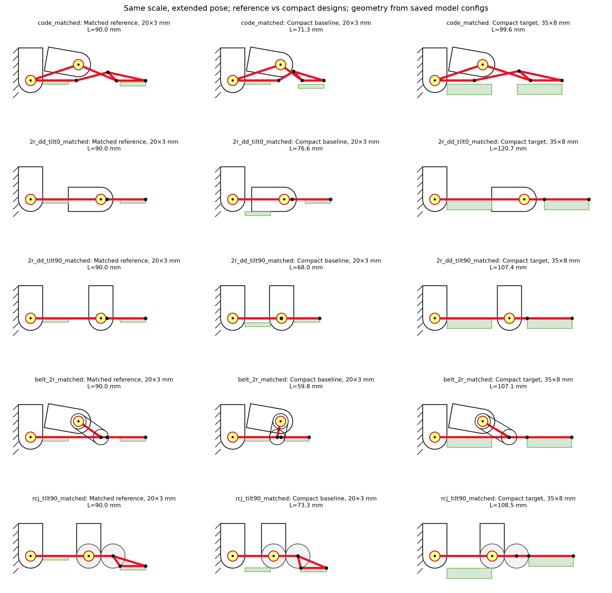

# Study 2 extension: compact morphology for given contact interfaces

2026-11-07 · feature/2dof-fe · source HEAD `4e77658448d877506ae4cf72bf461bdde6167683` plus recorded working-tree source snapshots.

## Question and relation to the North Star

For a fixed contact interface, what compact morphology can each architecture
find while preserving common articulation and contact requirements? Report how
its proximal/distal contact-bearing spans and articulation differ from a common
90 mm matched reference. This measures the spatial price of accommodation and
supports GOAL.md's aim of reducing interface-driven hand redesign and confounding.
It is not a manipulation-performance or hardware-buildability experiment.

The original Study2 allowed total length 70–110 mm and each external descriptor
within ±20 mm of the reference. Its results are preserved. The extension removes
that reference-proximity box and minimizes total length rather than eps_E first.

## Given interfaces

| Given interface | Proximal length × thickness (mm) | Distal length × thickness (mm) |
|---|---:|---:|
| baseline | 20 × 3 | 20 × 3 |
| thick | 20 × 8 | 20 × 8 |
| long | 35 × 3 | 35 × 3 |
| long_thick | 35 × 8 | 35 × 8 |
| asym_long_proximal | 40 × 3 | 20 × 8 |
| asym_long_distal | 20 × 8 | 40 × 3 |
| asym_proximal_heavy | 45 × 5 | 15 × 3 |
| asym_distal_heavy | 15 × 3 | 45 × 8 |

## Method and fair comparison

Seven original matched references, eight catalog targets, NSGA-II population100,
100 generations, seeds0/1/2. Every target/reference is optimized, even when its
matched reference carries the interface unchanged. All use required flexion120°,
existing mounting/servo/pivot/pad/face checks and existing E/Q/A partitions.
Interface dimensions are fixed. Architecture-specific actuation placement rules
and servo orientations are held; the remote shaft stays in the proximal frame,
and a joint-mounted servo follows its joint. No independent actuator relocation.

Primary objective: minimum absolute extended finger length. Secondary: minimum
maximum proximal-span, distal-span and articulation change (eps_shape)
within primary best-found length +0.1 mm. Total length is excluded from this
secondary norm because its fixed change would mask smaller shape changes.
The original full four-descriptor eps_E is reported separately. Pool
retained primary/secondary incumbents across seeds, then select minimum eps_shape
under the pooled best length +0.1 mm cap (sorted absolute shape changes break
retained-candidate ties, then length and eps_Q). The shortest actual secondary discovery
also counts toward the pooled length. Diagnostic secondary runs that included total length in the max norm were
retired, as that term masked shape changes. Valid primary searches were reused
after exact config/settings checks, and only secondary searches reran.
Selected designs are re-evaluated using
their saved stage configs. eps_Q is reported separately, never added to eps_E.

The common length domain starts [40,160] mm; a failed search or an upper-active
best triggers [40,240] mm. Support/span and dependent mechanism bounds propagate.
Belt shaft-to-joint dx covers shaft_x minus the permitted joint-position domain:
the former [-20,30] mm relative sampling box is not a physical belt-length limit.
Pulley geometry and all collision conditions remain. Other declared hardware and
mechanism layout bounds remain; this is not unrestricted physical design.

Initial baseline optimizer fronts from original Study2 provide deterministic warm
starts where present. Exact vectors/source IDs and per-stage configs/seeds are
saved. Main population100 admits all up-to40 recorded warm vectors; half of every
population remains exploration. See the study README for pilot admission limits,
source snapshots and warm replay. No new unrelated random design sampler.

The general nondominated archive has an exact scalar fast path: every minimum
scalar-objective row, retaining ties. Tests compare it to the original algorithm.
This changes runtime only. Early diagnostic belt trials with the old relative
box are retired under the result directory and excluded from the final dataset.
The original bounded Study2 also retained that relation box; its belt failures
therefore cannot establish an architecture-wide impossibility. A new feasible
result must be attributed to the expanded, consistently propagated domain, not
to removal of the total-length limit alone.

## Results: compact size

All numbers below are **best found nominal design-descriptor lengths**, not
certified global minima, in mm. They use the existing Study2 partition and
0.1 mm grid. CoDe link-length rounding/reassembly can slightly move the evaluated
fingertip; finalized CSVs separately retain assembled-length readback and its
difference. Do not interpret sub-grid rankings as physical precision. Ideal
RCJ removes the joint servo under the existing model and is a separate upper-bound
comparison. It is not a physical packaged competitor.

| Given interface | CoDe | DD 0° | DD 90° | Belt 2R | RCJ 0° | RCJ 90° | Ideal RCJ |
|---|---:|---:|---:|---:|---:|---:|---:|
| baseline | 71.3 | 76.5 | 67.9 | 59.7 | 76.7 | 73.2 | 59.5 |
| thick | 78.7 | 90.7 | 77.4 | 77.1 | 82.7 | 78.4 | 68.4 |
| long | 92.0 | 106.5 | 97.9 | 89.7 | 103.4 | 103.2 | 89.5 |
| long_thick | 99.6 | 120.7 | 107.4 | 107.1 | 108.4 | 108.4 | 98.2 |
| asym_long_proximal | not found | 105.2 | 90.2 | 88.4 | 97.1 | 97.1 | 83.6 |
| asym_long_distal | 96.8 | 105.1 | 90.1 | 89.9 | 100.9 | 97.1 | 84.0 |
| asym_proximal_heavy | not found | 99.9 | 88.5 | 83.2 | 95.6 | 95.3 | 81.1 |
| asym_distal_heavy | 98.4 | 105.2 | 90.2 | 88.4 | 103.9 | 96.9 | 83.6 |

There are 54/56 target/reference combinations with
at least one feasible retained design. Domain-edge-active selected solutions:
0. A failed search is not an impossibility result.

Physical best-found comparisons, without converting size into a universal merit:

- `baseline`: shortest physical best-found length 59.7 mm; within 0.1 mm: belt_2r_matched.
- `thick`: shortest physical best-found length 77.1 mm; within 0.1 mm: belt_2r_matched.
- `long`: shortest physical best-found length 89.7 mm; within 0.1 mm: belt_2r_matched.
- `long_thick`: shortest physical best-found length 99.6 mm; within 0.1 mm: code_matched.
- `asym_long_proximal`: shortest physical best-found length 88.4 mm; within 0.1 mm: belt_2r_matched.
- `asym_long_distal`: shortest physical best-found length 89.9 mm; within 0.1 mm: belt_2r_matched.
- `asym_proximal_heavy`: shortest physical best-found length 83.2 mm; within 0.1 mm: belt_2r_matched.
- `asym_distal_heavy`: shortest physical best-found length 88.4 mm; within 0.1 mm: belt_2r_matched.



The matched 90 mm reference is not a compactness optimum. Therefore shortening
relative to 90 mm includes ordinary baseline redesign, not just interface effects.
The following increments compare selected target designs against each
architecture's own selected compact baseline (also within the 0.1 mm length cap):

| Given interface | CoDe | DD 0° | DD 90° | Belt 2R | RCJ 0° | RCJ 90° | Ideal RCJ |
|---|---:|---:|---:|---:|---:|---:|---:|
| baseline | +0.0 | +0.0 | +0.0 | +0.0 | +0.0 | +0.0 | +0.0 |
| thick | +7.5 | +14.1 | +9.5 | +17.4 | +6.0 | +5.2 | +8.9 |
| long | +20.8 | +29.9 | +30.0 | +30.0 | +26.7 | +29.9 | +30.0 |
| long_thick | +28.3 | +44.1 | +39.4 | +47.3 | +31.7 | +35.2 | +38.7 |
| asym_long_proximal | — | +28.6 | +22.2 | +28.7 | +20.3 | +23.8 | +24.0 |
| asym_long_distal | +25.5 | +28.5 | +22.2 | +30.2 | +24.2 | +23.8 | +24.5 |
| asym_proximal_heavy | — | +23.3 | +20.5 | +23.5 | +18.9 | +22.0 | +21.5 |
| asym_distal_heavy | +27.1 | +28.6 | +22.3 | +28.7 | +27.2 | +23.7 | +24.1 |

## Morphology changes

Spans are common contact-bearing support lengths, not identical anatomical
phalanx links across mechanisms. Articulation is the extended ICR for CoDe, pin
for 2R and roller contact for RCJ. The selected design can be up to 0.1 mm longer
than the shortest retained design to reduce external morphology change.







All changes in this readback table are from the matched reference, in mm:

| Target / reference | Selected L | ΔL | Δ proximal span | Δ distal span | Δ articulation | Seeds found |
|---|---:|---:|---:|---:|---:|---:|
| baseline / code_matched | 71.3 | -18.7 | -0.3 | -0.4 | -9.0 | 3/3 |
| baseline / 2r_dd_tilt0_matched | 76.6 | -13.4 | 0.1 | 0.0 | -14.7 | 3/3 |
| baseline / 2r_dd_tilt90_matched | 68.0 | -22.0 | 2.7 | -0.2 | -16.7 | 3/3 |
| baseline / belt_2r_matched | 59.8 | -30.2 | -11.5 | -8.3 | -20.2 | 3/3 |
| baseline / rcj_tilt0_matched | 76.8 | -13.2 | 0.0 | -0.1 | -10.3 | 3/3 |
| baseline / rcj_tilt90_matched | 73.3 | -16.7 | -1.8 | 0.9 | -13.5 | 3/3 |
| baseline / rcj_ideal_matched | 59.6 | -30.4 | -7.7 | 1.1 | -19.4 | 3/3 |
| thick / code_matched | 78.8 | -11.2 | 0.0 | 0.0 | 0.0 | 3/3 |
| thick / 2r_dd_tilt0_matched | 90.7 | 0.7 | 0.0 | 0.0 | 0.0 | 3/3 |
| thick / 2r_dd_tilt90_matched | 77.5 | -12.5 | -0.1 | 0.1 | -11.5 | 3/3 |
| thick / belt_2r_matched | 77.2 | -12.8 | -5.8 | -8.7 | -11.5 | 3/3 |
| thick / rcj_tilt0_matched | 82.8 | -7.2 | 0.0 | 0.1 | -10.2 | 3/3 |
| thick / rcj_tilt90_matched | 78.5 | -11.5 | 0.3 | -0.2 | -6.4 | 3/3 |
| thick / rcj_ideal_matched | 68.5 | -21.5 | -4.4 | -1.2 | -15.9 | 3/3 |
| long / code_matched | 92.1 | 2.1 | 1.2 | 4.8 | -1.6 | 3/3 |
| long / 2r_dd_tilt0_matched | 106.5 | 16.5 | 1.2 | 4.8 | 0.2 | 3/3 |
| long / 2r_dd_tilt90_matched | 98.0 | 8.0 | 1.2 | 4.8 | -1.7 | 3/3 |
| long / belt_2r_matched | 89.8 | -0.2 | 1.2 | 4.8 | -5.2 | 3/3 |
| long / rcj_tilt0_matched | 103.5 | 13.5 | 1.2 | 4.8 | 1.2 | 3/3 |
| long / rcj_tilt90_matched | 103.2 | 13.2 | 1.2 | 4.8 | 1.2 | 3/3 |
| long / rcj_ideal_matched | 89.6 | -0.4 | 1.2 | 4.8 | -4.4 | 3/3 |
| long_thick / code_matched | 99.6 | 9.6 | 1.2 | 4.8 | 2.8 | 3/3 |
| long_thick / 2r_dd_tilt0_matched | 120.7 | 30.7 | 1.2 | 4.8 | 15.0 | 3/3 |
| long_thick / 2r_dd_tilt90_matched | 107.4 | 17.4 | 1.2 | 4.8 | 3.4 | 3/3 |
| long_thick / belt_2r_matched | 107.1 | 17.1 | 1.2 | 4.8 | 3.1 | 3/3 |
| long_thick / rcj_tilt0_matched | 108.5 | 18.5 | 1.2 | 4.8 | -0.6 | 3/3 |
| long_thick / rcj_tilt90_matched | 108.5 | 18.5 | 1.2 | 4.8 | -0.6 | 3/3 |
| long_thick / rcj_ideal_matched | 98.3 | 8.3 | 1.2 | 4.8 | -1.1 | 3/3 |
| asym_long_proximal / 2r_dd_tilt0_matched | 105.2 | 15.2 | 6.2 | 0.0 | 11.0 | 3/3 |
| asym_long_proximal / 2r_dd_tilt90_matched | 90.2 | 0.2 | 6.2 | 0.0 | 5.5 | 3/3 |
| asym_long_proximal / belt_2r_matched | 88.5 | -1.5 | 6.2 | -5.0 | 5.2 | 3/3 |
| asym_long_proximal / rcj_tilt0_matched | 97.1 | 7.1 | 6.2 | 0.0 | 3.1 | 3/3 |
| asym_long_proximal / rcj_tilt90_matched | 97.1 | 7.1 | 6.2 | 0.0 | 3.1 | 3/3 |
| asym_long_proximal / rcj_ideal_matched | 83.6 | -6.4 | 6.2 | 0.0 | 2.5 | 3/3 |
| asym_long_distal / code_matched | 96.8 | 6.8 | -4.5 | 9.8 | -5.3 | 3/3 |
| asym_long_distal / 2r_dd_tilt0_matched | 105.1 | 15.1 | 0.0 | 9.8 | -11.9 | 3/3 |
| asym_long_distal / 2r_dd_tilt90_matched | 90.2 | 0.2 | 0.9 | 12.6 | -15.9 | 3/3 |
| asym_long_distal / belt_2r_matched | 90.0 | 0.0 | -7.2 | 9.8 | -15.8 | 3/3 |
| asym_long_distal / rcj_tilt0_matched | 101.0 | 11.0 | 0.0 | 9.8 | -10.4 | 3/3 |
| asym_long_distal / rcj_tilt90_matched | 97.1 | 7.1 | 0.0 | 9.8 | -6.6 | 3/3 |
| asym_long_distal / rcj_ideal_matched | 84.1 | -5.9 | -7.1 | 9.8 | -18.8 | 3/3 |
| asym_proximal_heavy / 2r_dd_tilt0_matched | 99.9 | 9.9 | 11.2 | 0.0 | 11.3 | 3/3 |
| asym_proximal_heavy / 2r_dd_tilt90_matched | 88.5 | -1.5 | 11.2 | 0.0 | 8.8 | 3/3 |
| asym_proximal_heavy / belt_2r_matched | 83.3 | -6.7 | 11.2 | -10.6 | 5.6 | 3/3 |
| asym_proximal_heavy / rcj_tilt0_matched | 95.7 | 5.7 | 11.2 | 0.0 | 11.3 | 3/3 |
| asym_proximal_heavy / rcj_tilt90_matched | 95.3 | 5.3 | 11.2 | 0.0 | 11.5 | 3/3 |
| asym_proximal_heavy / rcj_ideal_matched | 81.1 | -8.9 | 11.2 | 0.0 | 5.5 | 3/3 |
| asym_distal_heavy / code_matched | 98.4 | 8.4 | -1.9 | 14.8 | -4.4 | 3/3 |
| asym_distal_heavy / 2r_dd_tilt0_matched | 105.2 | 15.2 | 0.0 | 14.8 | -14.0 | 3/3 |
| asym_distal_heavy / 2r_dd_tilt90_matched | 90.3 | 0.3 | 0.0 | 14.8 | -19.4 | 3/3 |
| asym_distal_heavy / belt_2r_matched | 88.5 | -1.5 | -10.7 | 14.8 | -19.4 | 3/3 |
| asym_distal_heavy / rcj_tilt0_matched | 104.0 | 14.0 | 0.0 | 14.8 | -10.4 | 3/3 |
| asym_distal_heavy / rcj_tilt90_matched | 97.0 | 7.0 | -0.9 | 14.8 | -12.6 | 3/3 |
| asym_distal_heavy / rcj_ideal_matched | 83.7 | -6.3 | -18.0 | 18.4 | -22.4 | 3/3 |

## Interpretation and limits

The compactness comparison is target-dependent. Belt has the shortest retained physical design on seven of the
eight catalog targets; CoDe does on long_thick. On that target the shortest
nominal lengths found are CoDe 99.6,
DD 0° 120.7,
DD 90° 107.4,
belt 107.1 and physical RCJ
108.4 mm. This is a conditional
size advantage, not general superiority. The ideal RCJ finds
98.2 mm under its no-joint-servo assumption.

Relative to their own selected compact baselines, long_thick adds
28.3 mm for CoDe versus
47.3 mm for belt.
Thus the architecture with the smallest baseline need not have the smallest
size increase under an interface change. This increment is descriptive of the
selected compact morphologies, not a causal decomposition of mechanical effects.

The expanded DD 0° domain finds long_thick at
120.7 mm, whereas the original
bounded Study2 did not find it. Its previous failure cannot be generalized beyond
that domain. Conversely, CoDe still finds no design for asym_long_proximal or
asym_proximal_heavy, at either upper limit and across all three seeds. Length
freedom alone therefore does not establish universal accommodation. Do not infer
an exact collision cause from these search failures.

Across successful cases the largest retained per-seed best-length range is
0.5 mm. The largest selected assembled/nominal length difference is
0.0329 mm. These checks support the stated reporting precision, not a
proof that every feasible basin was found.

For the North Star, retain original Study2 as the direct test of morphology
preservation, and use this extension to show the size and shape price when
compact accommodation is the priority. A future comparison of interface effects
should use matched or explicitly controlled morphologies; these independently
compacted designs do not remove the morphology confound.

Compactness and morphology preservation are different objectives. This experiment
answers the most compact accommodation question first, then reduces support/articulation
change among retained near-shortest designs. It does not establish the smallest
possible change to an existing hand; that was the original Study2's objective.
The compact-baseline increments help distinguish interface demand from generic
compaction, but different optimized morphologies still confound dynamics.

Every comparison remains conditional on current fixed-actuation, mounting,
2D collision/contact-face rules and finite domains. More total length need not
resolve a local fold, inaccessible contact face or fixed actuator-layout issue.
Neither successful search nor failed search is a mechanical acceptance test.
Production details, strength, width, cable retention and practical module
replacement are not established. Ideal RCJ remains separately labeled.

Three optimizer seeds assess search variability; candidate designs are not
statistical replicates. A single-objective archive can contain many tied designs.
The secondary search's cap is set per seed; pooled selection compares retained
incumbents under the common cap and does not prove a global lexicographic optimum.
Seed spread and the bound flags must accompany any smallest-size claim.
Primary-search histories are saved in `convergence.csv`: 7/162
feasible primary traces improved by more than 0.1 mm during generations81–100;
the largest such late improvement was 0.300 mm. These traces describe
primary-search convergence, not the additional secondary discoveries or a
global optimality certificate.

## Verification and reproducibility

The original bounded Study2 dataset is unchanged. Focused compact/domain,
actuator-preservation, serialization, length-cap, pooled-selection and scalar-front
tests plus existing Study1/2 and transmission regression tests: **72 focused and regression tests passed** (including archived warm replay,
shape-objective masking and primary-stage reuse).
One independent read-only reviewer found the cross-seed primary-candidate loss;
it was fixed and regression-tested. The same reviewer verified the aggregation,
belt-domain and scalar-front corrections. Selected-design achieved ROM and bound
flags are refreshed from actual saved-config feasibility readback, addressing its
remaining metadata caveat. Verified selected designs: 54.

Results: `output/study/study2_compact_morphology/` contains per-seed stages,
exact warm vectors, source snapshots, inputs, per-seed and finalized best tables,
and aggregation provenance. Figures read the finalized tables and saved configs;
figure manifests contain input hashes and source snapshots. Configs and full
formulation: `scripts/study/study2_compact_morphology/README.md`.

```
python scripts/study/study2_compact_morphology/run.py [fresh-output-config.yaml]
python scripts/study/study2_compact_morphology/finalize.py [output-directory]
python scripts/study/study2_compact_morphology/figures.py --source [output-directory]
```

For exact warm replay, point `warm_start.replay` to the archived `targets/`
directory and choose a fresh output. No commit, push or hardware experiment.
