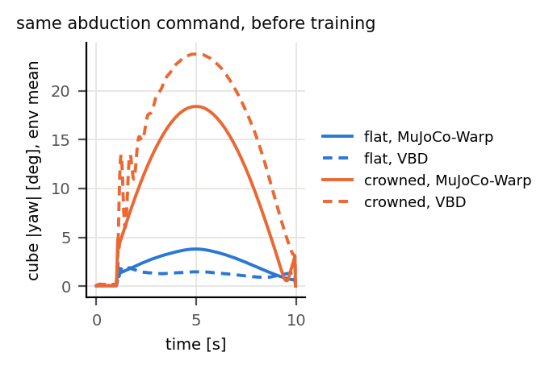
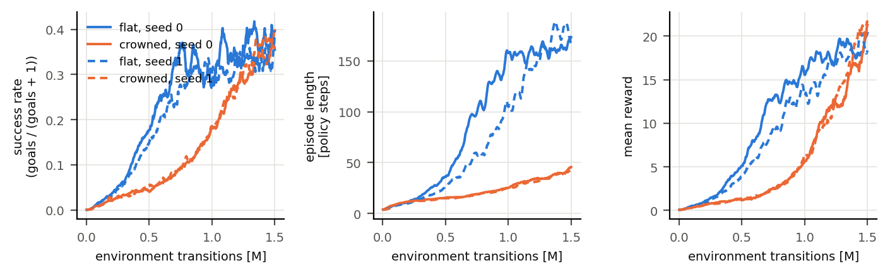
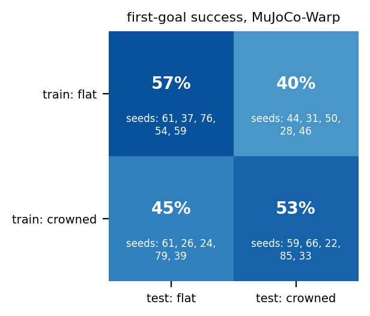
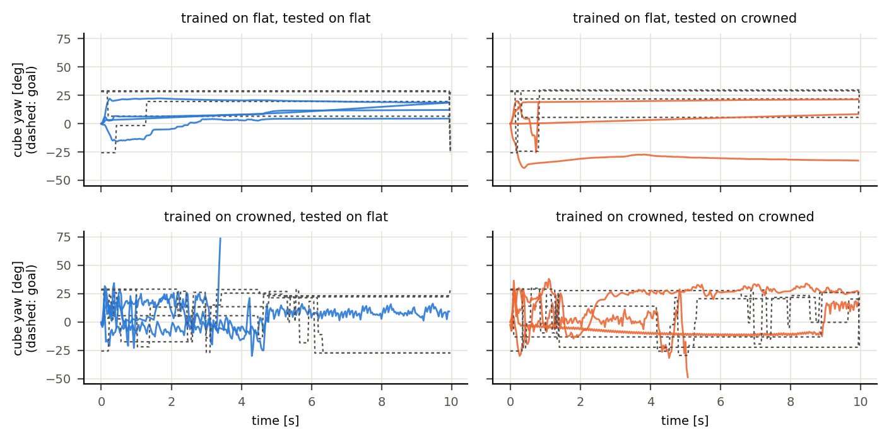

# Study 3 pilot: 접촉면 형상, RL, solver 간 전이

> 2026-11-21: 이 pilot이 속한 Study 3 계획(interface A/B, contact model, 접근성)은 `docs/experimental/study3_interface_platform.md`로 보관되었다. 지금의 Study 3는 한 질문만 다룬다(`design/SSoT/research-objective.md` 8절). 아래 결과는 바꾸지 않는다.

작성: 2026-11-21. 상태: pilot 완료. Study 3A는 형상마다 seed 5개로 결과를 냄. Study 3B는 solver 검증에서 막혀 해석하지 않음(seed 0–1로 실행). 시뮬레이션만의 예비 결과이며, 손의 질량·관성·관절 한계·servo armature는 placeholder다.

원칙: **로봇은 고정하고 접촉면만 바꾼다.**

## 1. 질문과 가설

- **3A.** 관절과 구동을 고정하고 접촉면 형상만 바꾸면, 학습 결과와 형상 간 정책 전이가 달라지는가.
  - H3A.1: 접촉면 형상은 학습 결과와 조작 행동에 영향을 준다.
  - H3A.2: 한 형상에서 학습한 정책은 다른 형상에서 재학습 없이 성능을 잃을 수 있다.
- **3B.** 같은 정책을 다른 solver로 옮길 때, 접촉 모델 차이에 대한 민감도가 형상마다 다른가. 비교는 Newton 안의 MuJoCo-Warp → VBD이며, 독립된 엔진 사이의 전이가 아니다.

가설은 확인할 대상이지 전제가 아니다.

## 2. 설정과 통제 변수

**손.** `design/core/morphology/code_hand/pivot8_balanced.yaml`의 export(`design/output/sim/study3/code_hand_pivot8.json`, commit `1868a4d`, clean, sha256 `5c73f191…`)를 썼다. legacy export와 몸체·관절·loop·pad가 같다. 손가락 셋은 crossed four-bar이고 엄지는 placeholder capsule이다. actuated joint 13개, passive joint 6개, loop 3개다.

**접촉면 형상** (`sim/isaaclab/src/code_isaaclab/contact_interface.py`):

| | M0 flat | M1 crowned |
|---|---|---|
| 접촉면 | 평면 | pad 길이 방향 원호, 끝이 가운데보다 2.0 mm 낮음 |
| 길이 × 폭 | 35.6 × 19 mm (proximal), 33.8 × 19 mm (distal) | 같음 |
| 두께 | 3.0 mm | 가운데 3.0 mm, 끝 1.0 mm |
| 원호 반경 | – | 80.2 mm (proximal), 72.4 mm (distal) |
| mounting 면 | export 그대로 | 같음 (crowned는 flat 안에 들어감) |
| collider | 볼록 mesh, vertex 8개 | 볼록 mesh, vertex 38개 |
| USD | `code_hand_pivot8_flat_79bd7e047043.usda`, sha256 `88b716ee…` | `code_hand_pivot8_crowned_61c94d056cc3.usda`, sha256 `fb3454d4…` |

두 형상 모두 볼록 mesh로 썼다. box primitive와 mesh는 충돌 알고리즘이 달라서, 그 차이가 형상 효과에 섞이지 않게 하기 위해서다. 다음을 테스트로 확인했다(`sim/isaaclab/tests/test_contact_interface.py`).

- 두 USD는 prim, attribute, schema가 모두 같고, pad 6개의 `points`와 topology만 다르다.
- 두 task는 관절 이름·순서, action·관측 차원, 보상, 종료 조건, reset, actuator, 초기 자세가 같고 USD 경로만 다르다.
- Newton에 들어간 collider도 확인했다. 둘 다 `CONVEX_MESH`이고, crowned는 끝이 가운데보다 정확히 2.0 mm 낮다.

질량은 export의 몸체 질량 그대로다. pad는 asset에서 질량이 없다.

**Task** (`CoDe-Reorient-Cube-CoDeFlat`, `CoDe-Reorient-Cube-CoDeCrowned`). upstream reorientation MDP(관측, action, 보상, goal 재추첨, 성공 판정 0.2 rad)를 그대로 쓰고, CoDe 손에 맞춰 다음만 바꿨다. 두 형상에 똑같이 적용한다.

| 항목 | upstream (Allegro) | CoDe | 이유 |
|---|---|---|---|
| 손 자세 | Allegro 고유 | 손바닥 위(x축 180°) | – |
| 물체 | DexCube ×1.2 | 50 mm, 50 g cube, 펼친 손가락의 pad 위 | 손 크기 |
| goal | SO(3) 균등 | 수직축 회전 ±30°, 연속 goal 20° 이상 간격 | 아래 참조 |
| reset | 무작위 방향 낙하, 관절 noise 0.2 | 정자세, 위치 noise ±3 mm, 관절 noise 0.02 | noise 0.2는 평평한 손에서 cube를 떨굼 |
| 떨어짐 판정 | 24 cm | 8 cm | 손 크기 |

goal 축은 학습 전에 flat 형상으로만 한 scripted probe로 정했다. 손가락 셋을 함께 벌리면 cube가 pad 5–6개에 놓인 채 수직축으로 돌았다. 굽히면 cube가 손바닥 쪽으로 넘어갔다(y축 93°, pad 외 접촉 발생). 평행한 세 손가락은 재파지 없이 SO(3)의 대부분에 닿지 못한다.

**구동.** XM335 implicit servo(PD 선형화)를 학습과 두 solver 평가에 모두 쓴다. explicit DC-motor 모델은 VBD에서 loop가 수 m 벌어져(3절) 3B가 불가능했다. implicit 모델은 큰 동작을 실제 모터의 무부하 속도보다 2–4배 빠르게 낸다(E6). MuJoCo-Warp 접촉 buffer는 nconmax 256, njmax 1024다(5절의 overflow 참조).

**학습.** upstream Allegro manager PPO 설정을 그대로 썼다(MLP 512-256-128, lr 1e-3 adaptive, γ 0.998, 24 step/env). 형상마다 같다.

| 항목 | 값 |
|---|---|
| env | 128 |
| iteration | 488 |
| transition | 1,499,136 |
| seed | 0–4 (3B의 VBD 재생은 0–1) |
| physics | MuJoCo-Warp(`newton_mjwarp`: implicitfast, elliptic cone, impratio 10, substep 2, dt 1/120 s, decimation 4) |

**평가.** 각 checkpoint의 결정적(평균) action을 쓰고 정책은 고정한다. env 256개가 각자 첫 episode 하나를 둔다(eval seed 1000). 그래서 16칸 모두 cube 위치 noise, 관절 noise, 첫 goal이 같다. 초기 상태 hash가 16칸 전부 하나였다.

- **주 지표**: 첫 goal 도달 여부(여기서만 조건이 정확히 맞춰짐).
- **보조 지표**:
  - held success: 첫 goal 도달 후 1초(30 step) 안에 떨어뜨리지 않은 경우.
  - 그 밖에 떨어뜨림, 도달한 goal 수, 접촉, action, loop 잔차를 episode마다 기록한다.

## 3. 시뮬레이션 검증 (Gate 0)

`validate_env.py`, env 16개, 300 step(10 s). 정책은 hold(기본 자세 목표), zero(upstream의 0, 곧 관절 범위의 중간), random(seed 42), abduct(세 손가락 AA를 30°까지 천천히 벌렸다 되돌림)이다. 값은 `report/study3/tables/validation.csv`에 있다.

| 형상 / solver / 정책 | 떨어뜨림 | 추종 오차 [rad] | loop 잔차 최대 [mm] | passive 동기 최대 [rad] | 기타 |
|---|---|---|---|---|---|
| 둘 다 / MuJoCo-Warp / hold | 0 | 0.0009 | 0.011 | 0.0008 | pad 5.9–6.0개 접촉, self-contact 0 |
| 둘 다 / MuJoCo-Warp / abduct | 0 | 0.0010 | 0.011 | 0.0008 | |
| 둘 다 / MuJoCo-Warp / zero | 1600 | 0.134 | 0.12 | 0.006 | 손가락이 중간으로 튀어 cube를 튕김 |
| 둘 다 / MuJoCo-Warp / random | 1356–1377 | 0.28 | 0.89 | 0.048 | 이웃 손가락끼리 접촉 최대 460 N |
| 둘 다 / VBD / hold, abduct | 0 | 0.001–0.003 | 0.03–0.08 | 0.012–0.027 | |
| 둘 다 / VBD / zero, random | 3649–4109 | – | 423–782 | 6.8–7.4 | **loop가 벌어짐** |

**MuJoCo-Warp는 통과했다.**

- 손 몸체는 유한하고, loop가 닫혀 있으며, passive joint가 동기된다.
- 의도한 pad만 cube에 닿는다. pad 접촉력 합은 cube 무게 0.49 N과 같다.
- 손가락 안의 self-contact는 0이다.
- random에서 생기는 큰 접촉은 이웃 손가락끼리다. 손가락 간격 25 mm, pad 폭 19 mm에 AA ±30°(stop 없는 placeholder)이라 물리적으로 생기는 접촉이다. 수백 N의 순간 힘은 침투 해소 때문이다.

**VBD는 부분적으로 통과했다.** 느린 지령에서는 정상이지만, 크고 빠른 지령에서는 four-bar loop가 수백 mm 벌어진다. 추가 실패도 있다.

- explicit DC-motor servo는 hold에서도 loop가 수 m 벌어진다. 그래서 servo를 implicit로 통일했다.
- VBD는 contact sensor를 지원하지 않는다(`SolverVBD.update_contacts` 미구현). 접촉 진단은 MuJoCo-Warp에서만 했다.

같은 abduct 지령에서 cube의 최대 수직축 회전(그림 `figures/study3b_prescribed_abduction.png`):

| | flat | crowned |
|---|---|---|
| MuJoCo-Warp | 0.066 rad (3.8°) | 0.321 rad (18.4°) |
| VBD | 0.033 rad (1.9°) | 0.415 rad (23.8°) |

손가락 벌림에 cube가 따라 도는 정도는 crowned가 flat보다 5–13배 컸고, 두 solver에서 방향이 같다. 학습 전의 수동 접촉 효과다.



**처리 속도.**

| 단계 | 속도 |
|---|---|
| 학습 (MuJoCo-Warp, 128 env, 진단 없음) | 약 4,400 transition/s, run당 342–370 s |
| 진단 포함 rollout (16 env) | MuJoCo-Warp 약 900 env-step/s, VBD 약 250 env-step/s |

## 4. Study 3A 결과 (MuJoCo-Warp, 형상마다 seed 5개)



**학습 곡선.** flat의 다섯 seed는 비슷하게 오른다. crowned는 두 갈래다.

- seed 0과 1은 1.0M 이후에야 오르고 episode가 짧다(41–42 step).
- seed 2–4는 flat과 같거나 더 빨리 오른다.

seed 2개만 보았을 때의 "crowned가 늦게 배운다"는 이 갈래 하나였다.

**고정 checkpoint 평가.** 조건마다 episode 256개이고, 칸 하나의 성공률 표준오차는 약 0.03이다. 표는 `tables/cells.csv`에 있다.

| 학습 → 시험 | seed 0 | 1 | 2 | 3 | 4 |
|---|---|---|---|---|---|
| flat → flat: 첫 goal / held / 떨어뜨림 | 0.61 / 0.59 / 0.18 | 0.37 / 0.34 / 0.21 | 0.76 / 0.70 / 0.37 | 0.54 / 0.54 / 0.08 | 0.59 / 0.57 / 0.16 |
| flat → crowned | 0.44 / 0.42 / 0.20 | 0.31 / 0.30 / 0.16 | 0.50 / 0.48 / 0.25 | 0.28 / 0.27 / 0.15 | 0.46 / 0.45 / 0.14 |
| crowned → crowned | 0.59 / 0.48 / 0.65 | 0.66 / 0.52 / 0.95 | 0.22 / 0.21 / 0.16 | 0.85 / 0.24 / 0.71 | 0.33 / 0.32 / 0.08 |
| crowned → flat | 0.61 / 0.53 / 0.65 | 0.26 / 0.12 / 0.99 | 0.24 / 0.20 / 0.21 | 0.79 / 0.13 / 0.83 | 0.39 / 0.38 / 0.20 |
| pad 외 힘 [N], in-domain: flat / crowned | 0.0 / 17.5 | 0.0 / 15.0 | 0.1 / 0.3 | 0.5 / 0.0 | 0.0 / 0.0 |



**seed를 단위로 한 검정.** `tables/seed_stats.csv`에 있다. in-domain 비교는 정확 permutation 검정(5 대 5, 배치 252가지)이고, 전이 격차는 정확 sign-flip 검정(32가지, 최소 p 0.0625)이다. 다중비교 보정은 하지 않았다.

| 비교 | flat | crowned | 차이 / 효과 크기 | p |
|---|---|---|---|---|
| in-domain 첫 goal 성공 | 0.573 ± 0.140 | 0.530 ± 0.256 | −0.04, g −0.19 | 0.75 |
| in-domain held success | 0.548 ± 0.129 | 0.353 ± 0.138 | −0.20, g −1.32 | 0.048 |
| in-domain 떨어뜨림 | 0.198 ± 0.105 | 0.509 ± 0.372 | +0.31, g 1.03 | 0.14 |
| in-domain pad 외 힘 [N] | 0.13 ± 0.22 | 6.6 ± 8.9 | g 0.93 | 0.26 |
| 전이 격차 flat → crowned, 첫 goal | +0.176 ± 0.086 (5/5 양수) | | | 0.0625 (paired t: 0.010) |
| 전이 격차 flat → crowned, held | +0.166 ± 0.087 (5/5 양수) | | | 0.0625 |
| 전이 격차 crowned → flat, 첫 goal | +0.075 ± 0.189 | | | 0.69 |
| 전이 격차 crowned → flat, held | +0.080 ± 0.191 | | | 0.50 |

seed 간 분산도 비교했다(Brown–Forsythe, 정확 permutation). crowned 학습이 더 흩어져 보이지만 유의하지 않다(떨어뜨림 p 0.12, 첫 goal p 0.23, pad 외 힘 p 0.13).

**행동.** 대표 episode는 `figures/study3_trajectories_seed{0..4}.png`에 있다.

- flat 정책은 다섯 모두 cube를 쥐고 첫 goal 쪽으로 한 번 부드럽게 돌린다(떨어뜨림 0.08–0.37, pad 외 힘 0.5 N 이하).
- crowned 정책은 갈린다.
  - seed 0과 1은 pad 외 몸체로 cube를 누르며(15–17.5 N) 빠르게 흔들어 goal을 여럿 쫓다가 떨어뜨린다.
  - seed 3은 pad만 쓰지만 첫 goal 뒤 대부분 떨어뜨린다(held 0.24, 떨어뜨림 0.71).
  - seed 2와 4는 flat 정책처럼 쥐고 돈다.



## 5. Study 3B 결과 (MuJoCo-Warp → VBD): 해석하지 않음

정책 16칸을 모두 VBD에서 재생했다(재학습 없음). 표는 `tables/cells.csv`, `tables/solver_gaps_*.csv`에 있다.

| 학습 | seed | 시험 | VBD 첫 goal | VBD 떨어뜨림 | episode 길이 | loop 유효 비율 |
|---|---|---|---|---|---|---|
| crowned | 0, 1 | 둘 다 | 0.000–0.004 | 1.00 | 1.5 step | 0.60–0.64 |
| flat | 0 | 둘 다 | 0.000–0.004 | 0.99 | 14–15 | 0.86–0.91 |
| flat | 1 | flat / crowned | 0.289 / 0.246 | 0.88 / 0.95 | 62 / 53 | 0.73 / 0.78 |

8칸 가운데 6칸에서 정책이 첫 1–15 step 안에 cube를 튕겨 낸다. 같은 정책이 MuJoCo-Warp에서는 86–268 step을 쥔다.

**3B를 해석하지 않는 이유.** Gate 0에서 VBD는 크고 빠른 지령에서 loop가 수백 mm 벌어졌고, zero 지령에서는 episode가 평균 약 1 step이었다. 학습된 정책의 action은 평균 |a| 1.4–2.2로 관절 한계를 넘는 목표, 곧 step 지령에 가깝다. 정확히 VBD가 검증을 통과하지 못한 영역이다.

VBD를 반복 100회 × substep 8로 강하게 해 보았다(`logs/study3_pilot/eval_vbd_stiffer/`, episode 64개).

| 정책 | loop 유효 비율 | 떨어뜨림 |
|---|---|---|
| flat s0 | 0.92 | 1.00 |
| crowned s0 | 0.94 | 1.00 |

loop는 대부분 유지됐지만 두 정책 모두 cube를 전부 떨어뜨렸다. 즉 이 구성의 VBD에서는 두 형상이 모두 바닥에 닿는다. SolverGap은 형상과 무관하게 in-domain 성공률과 같아지므로 형상 간 강건성을 판별할 수 없다.

loop 파손(수치 실패)과 강한 접촉 반발(접촉 모델 차이)이 섞여 있어, 이 격차를 접촉 모델 차이만의 효과로 볼 수도 없다. 계획대로 cross-solver RL 비교는 여기서 멈춘다.

3B에서 유효한 자료는 학습 전 느린 지령의 비교(3절)뿐이다. flat은 VBD에서 cube 회전이 절반으로 줄었고(3.8° → 1.9°), crowned는 늘었다(18.4° → 23.8°). 솔버 차이가 cube의 반응을 바꾸는 방향과 크기는 형상마다 다르다. 다만 지령 하나에서 나온 값이다.

## 6. 관찰된 confound와 한계

- **placeholder 동역학.** 질량, 관성, 직구동 관절 한계(AA ±30°, stop 없음), servo armature, pad 폭(19 mm), 손바닥(capsule)과 엄지(pad 없음)가 모두 placeholder다.
- **implicit servo.** 큰 동작이 실제 모터보다 2–4배 빠르다. 정책 action이 거의 포화되어 있어(평균 |a| 1.4–2.2), 실제 servo의 속도 한계가 결과를 바꿀 수 있다.
- **goal 분포.** 수직축 ±30°로, upstream의 SO(3)보다 훨씬 쉽다. 축은 flat 형상의 probe로만 정했다.
- **학습 예산과 seed.** 1.5M transition에서 여러 run이 수렴하지 않았다(그림의 끝 기울기). seed는 형상마다 5개라 seed 간 차이(flat 첫 goal 0.37–0.76)가 크고, 검정력이 낮다. 지표를 미리 하나로 정하지 않아 다중비교 보정을 하지 않았다.
- **평가의 반복 오차.** MuJoCo-Warp의 GPU 계산은 완전히 결정적이지 않다. 같은 checkpoint, 같은 초기 상태의 재평가 값이 처음 값과 최대 0.05 다르다(예: flat s1 on crowned 0.309 대 0.359). 칸 하나의 차이 0.05 이하는 해석하지 않는다. 전이 격차의 부호는 재평가에서도 다섯 seed 모두 같았다.
- **성공 지표.** 첫 goal은 조건 간에 정확히 맞춰지지만, 그 뒤의 goal은 조건마다 다른 시점에 뽑혀 맞춰지지 않는다. crowned 정책은 첫 goal에는 닿고 곧 떨어뜨리므로, 첫 goal만 보면 조작 품질을 과대평가한다. 그래서 held success와 떨어뜨림을 함께 보고했다.
- **pad 외 접촉의 출처.** 어느 몸체(엄지, link, 이웃 손가락)인지는 아직 분해하지 않았다. 지금은 합만 있다.
- **VBD.** contact sensor 미지원, loop 파손, 강한 접촉 반발이 있다.
- **처음 학습은 폐기했다.** MuJoCo-Warp 접촉 buffer(기본 120)가 넘쳐 일부 접촉이 버려졌다. buffer를 늘리고 Gate 0부터 다시 했다. 최종 학습·평가 log의 overflow는 0이다.
- **기록되지 않은 값.** 학습 manifest의 GPU 메모리는 학습 process가 아니라 wrapper의 값이라 의미가 없다.

## 7. 데이터가 지지하는 것과 지지하지 않는 것

**지지함 (시뮬레이션, 형상마다 seed 5개, 1.5M transition, 예비):**

1. 실제 CoDe 손(crossed four-bar 셋, loop 닫힘)이 접촉면만 다른 두 형상으로 같은 RL task를 학습한다. in-domain 첫 goal 성공은 0.22–0.85다.
2. **flat에서 학습한 정책은 crowned 손에서 성능을 잃는다.** 다섯 seed 모두 그렇다(첫 goal +0.18 ± 0.09, held +0.17 ± 0.09). 부호 검정 p 0.0625는 seed 5개로 얻을 수 있는 최소값이고, paired t 검정은 p 0.010이다. 같은 초기 상태에서 다시 평가해도 다섯 모두 양수였다(+0.16, +0.02, +0.23, +0.31, +0.14). 떨어뜨림은 늘지 않는다(+0.02).
   - **원인 가설을 미리 세우고 시험했고, 기각됐다.** 가설은 "학습 전 같은 벌림이 crowned에서 cube를 5–13배 더 돌리므로, flat에 맞춘 정책은 crowned에서 goal을 지나친다(overshoot)"였다. 모든 episode의 cube yaw를 기록해 첫 goal 실패를 분류했다(`scripts/study3/transfer_mechanism.py`, `tables/transfer_mechanism.csv`).
   - 결과는 반대였다. crowned에서 undershoot(goal보다 0.2 rad 넘게 모자람)가 늘었고(+0.136 ± 0.102, 5/5 seed, p 0.0625), overshoot는 줄었으며(−0.016, 0/5), 첫 1초의 cube 회전도 줄었다(−0.041 rad, 4/5 감소).
   - 곧 flat 정책은 crowned pad 위에서 cube를 **충분히 돌리지 못해** 실패한다. 미리 정한 지령 하나에서 잰 형상 효과(crowned가 더 돌림)는 피드백으로 움직이는 정책의 전이 실패를 예측하지 못한다. 정책이 쓰는 동작은 미리 정한 벌림과 다르다.
3. **학습 전 수동 접촉 효과.** 같은 벌림 지령에서 crowned가 cube를 5–13배 더 돌린다. 두 solver에서 방향이 같다.

**약하게 지지함:**

4. crowned에서 학습한 정책은 첫 goal 뒤 cube를 덜 지킨다(held 0.35 대 0.55, g −1.32, p 0.048). 지표 8개 중 하나라 보정하면 남지 않는다.

**지지하지 않음:**

1. 형상이 첫 goal 성공을 바꾼다는 것(0.57 대 0.53, p 0.75).
2. 형상이 학습 전략을 일관되게 바꾼다는 것. seed 2개에서는 그렇게 보였지만, 다섯 개에서는 crowned 정책 중 둘만 pad 외 접촉에 기댔다(p 0.26).
3. crowned에서 학습한 정책이 flat 손에서 성능을 잃는다는 것(+0.08 ± 0.19, p 0.69). 전이 격차는 비대칭이다.
4. 형상에 따른 solver 강건성(3B). VBD가 이 정책들을 안정하게 평가하지 못한다.

## 8. 다음 실험 추천

더 큰 Study 3A는 정당화된다. 가장 확실한 신호는 flat → crowned 전이 손실(5/5 seed)이고, 그 다음은 held success의 차이다.

1. **수렴까지, seed 10개.** 형상마다 seed 10개로 success가 평탄해질 때까지(5–10M 예상) 학습한다. 주 지표는 전이 격차와 held success로 미리 정한다. 그러면 보정 없는 다중비교 문제가 사라진다. 이번의 전이 격차 크기(0.18 ± 0.09)라면 seed 10개로 충분하다.
2. **전이 비대칭의 원인.** overshoot 가설은 기각됐다(7절). 다음 가설은 "flat 정책은 넓은 면 접촉의 마찰 torque에 기대는 동작(관절별 기여는 미측정)을 쓰고, crowned의 선 접촉에서는 그 torque가 작다"이다. 이를 시험하려면 정책 rollout의 관절별 action과 pad별 접촉 위치·힘을 함께 기록해야 한다.
3. **pad 외 접촉을 몸체별로 기록한다.** crowned seed 0과 1의 전략이 어디에 기대는지(엄지, link, 이웃 손가락) 밝힌다.
4. **3B는 solver 검증부터 다시 한다.** 두 형상에 똑같이 action 변화율 제한(EMA α < 1)을 둔 task로 다시 학습한다. 아니면 큰 step 지령에서 loop와 cube를 유지하는 backend 설정(VBD 강화, Kamino)을 먼저 찾는다. 그 전에는 cross-solver 점수를 내지 않는다.
5. **placeholder를 줄인다.** explicit servo, AA stop, 엄지 pad.

## 9. 재현

monorepo의 `sim/isaaclab/`에서 실행한다(design 단계는 conda `cmd` 환경).

```bash
bash scripts/study3/run_pilot.sh export     # design: python scripts/export/code_hand_sim.py --params core/morphology/code_hand/pivot8_balanced.yaml --out output/sim/study3/code_hand_pivot8.json
bash scripts/study3/run_pilot.sh validate   # Gate 0: 2 형상 x 2 solver x {hold, zero, random, abduct}
bash scripts/study3/run_pilot.sh train      # PPO: 2 형상 x seed {0,1}, 488 iteration x 24 x 128 env (seed 2-4: train.py --seed 2|3|4)
bash scripts/study3/run_pilot.sh eval       # 16칸, episode 256개, eval seed 1000
bash scripts/study3/run_pilot.sh analyze    # report/study3/figures, report/study3/tables
PYTEST_DISABLE_PLUGIN_AUTOLOAD=1 uv run pytest -q tests   # 형상 불변성과 task 등록 테스트 포함 20개
```

개별 명령:

```bash
uv run python scripts/study3/validate_env.py --variant flat --policy abduct --amplitude 0.5 --num_envs 16 --steps 300 physics=newton_mjwarp
uv run --extra rsl-rl python scripts/study3/train.py --variant crowned --seed 1 --iterations 488
uv run --extra rsl-rl python scripts/study3/eval_policy.py --run logs/rsl_rl/study3_code_reorient/<run> --test_variant flat --episodes 256 --eval_seed 1000 physics=newton_vbd
# VBD를 강하게 한 보조 평가
uv run --extra rsl-rl python scripts/study3/eval_policy.py ... physics=newton_vbd env.sim.physics.solver_cfg.iterations=100 env.sim.physics.num_substeps=8
```

**환경.** Isaac Lab 3.0.0(`isaaclab` 28.0.1, commit `44044b09`), Newton 1.6.1, MuJoCo-Warp 3.12.0, PyTorch 2.11.0+cu130, RSL-RL 5.5.1, Python 3.12.12, RTX 4070 Ti SUPER(16 GB).

**기록.** 학습 run마다 `study3_manifest.json`이 git 상태, 자산 hash, transition, wall time, checkpoint sha256, overflow 수를 담는다. 평가 run마다 `summary.json`이 checkpoint sha256, solver 설정, 초기 상태 hash, manifest를 담는다. 둘 다 `sim/isaaclab/logs/`에 있고 git에는 넣지 않는다.

**원자료.**

- `report/study3/tables/episodes.csv.gz`: 16칸 × 256 episode.
- `tables/cells.csv`, `transfer_gaps_*.csv`, `solver_gaps_*.csv`, `training.csv`, `validation.csv`.
