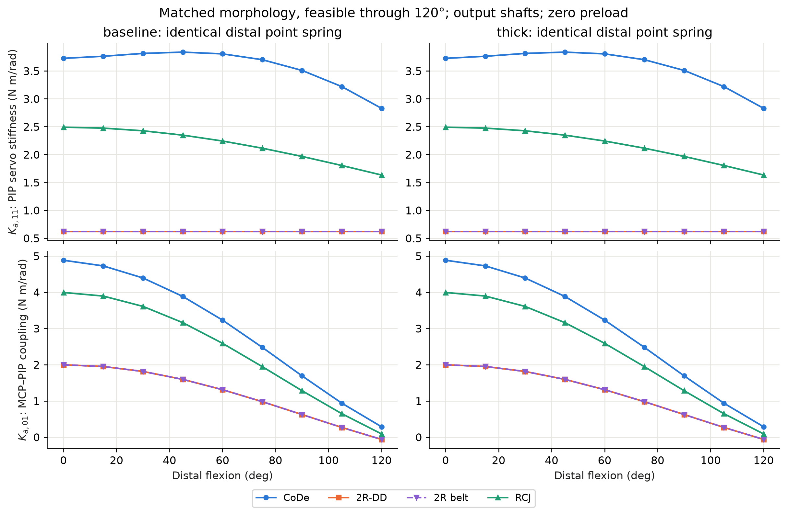
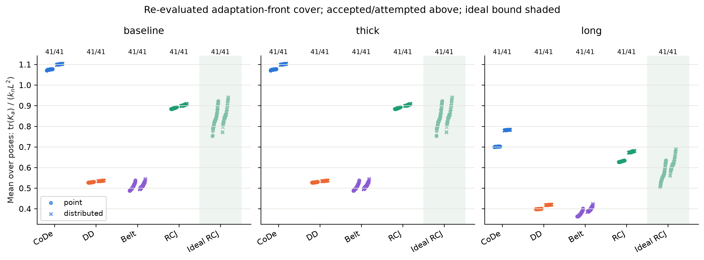
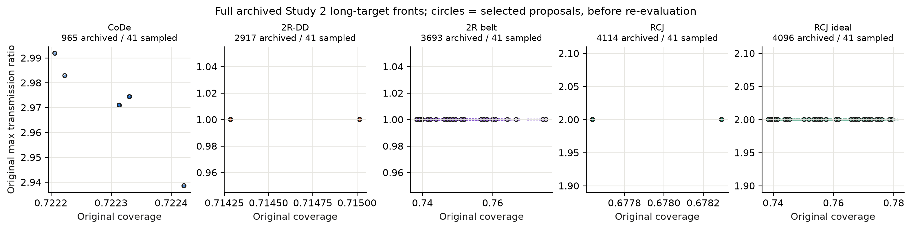
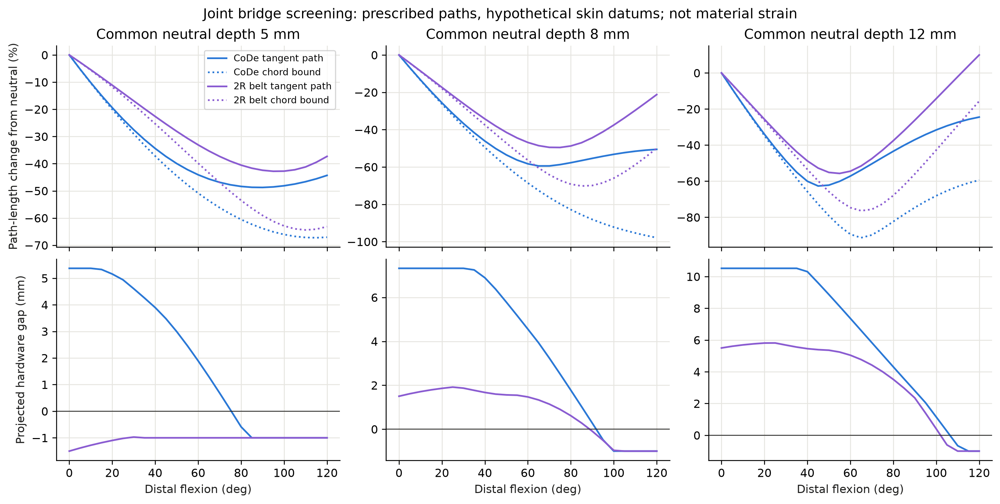
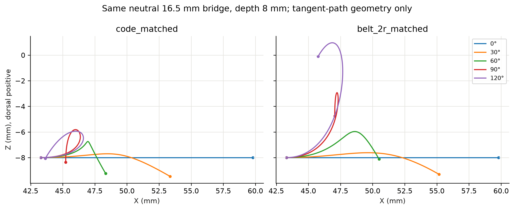

# CoDe Hand: Studies 3–4

2026-11-07 · `feature/2dof-fe` · source HEAD `4e77658448d877506ae4cf72bf461bdde6167683`

## Research decision

Study 3 establishes a reusable local transmission-to-contact comparison.
Identical contact laws give different actuator-side stiffness matrices even
on the matched reference morphology. This is a source of embodiment dependence
to measure when interpreting interface experiments, not an architecture ranking.
Study 4 does **not** support a general reduction of bridge deformation burden
from CoDe's polycentric motion. Its geometric constructions expose substantial
shortening, self-intersection and routing limitations. They do not establish a
usable continuous joint skin. Stop before beam/FEM for this construction.

The governing problem remains the root [GOAL.md](../GOAL.md): functional contact
interfaces need volume that competes with servo bodies and articulation hardware.
Changing interfaces can force expensive morphology redesign, and changing both
confounds manipulation-performance attribution. CoDe aims to make systematic
interface variation practical while preserving underlying morphology, actuation
and articulation as consistently as practical. These studies support that goal;
they do not replace it with a stiffness competition or skin-design project.

## Baseline and provenance

The local branch matched the latest remote HEAD at inspection. The working tree
already contained substantial Study 1–2 changes and results. Their formulations,
source files and results were preserved. `GOAL.md` already existed; it was
shortened around the agreed North Star and extended with Study 3–4 claim discipline.

The referenced ChatGPT conversation confirmed reuse of optimizer/Pareto designs
and the lightweight joint-interface question. `/mnt/data/붙여넣은 마크다운.md` was
not present. Its content is not assumed or reconstructed. The analysis uses the
repository's inspected Study 1–2 docs, current evaluators, FK and saved outputs.

No optimization was rerun. The initial pilot exposed obsolete native-front
mounting assumptions and objective ties. The final secondary comparison instead
uses the existing Study 2 `long`, seed 0, Level 2 mechanism fronts under current
formulations. All are adaptation-conditioned design alternatives, not native
architecture-optimal fronts or statistical replicates.

| Original front | Archived designs | Selected proposals |
|---|---:|---:|
| Physical CoDe | 965 | 41 |
| Direct-drive 2R, servo 90° | 2,917 | 41 |
| Belt 2R, servo 10° | 3,693 | 41 |
| Physical RCJ, servo 90° | 4,114 | 41 |
| Ideal RCJ, no joint servo | 4,096 | 41 |
| Total | 15,785 | 205 |

Select a deterministic cover in normalized original objective space, using
normalized design distance for objective ties. All these saved mechanism-cost
fronts have tied objective values within each front; geometry therefore matters
to coverage. Selected vectors are distinct to 1e-8 mm/deg. The complete archived
fronts, run metadata, exact selected CSV indices and hashes are retained. Full
archived distributions are shown for context; reflected dynamics are evaluated
on the selected covers, not on all 15,785 rows. No confidence intervals or
statistical significance claims are made.

## Study 3: formulation

Use the existing contact faces and mechanism FK. World is the XZ side view, O at
MCP, +X distal and +Z dorsal. Positive flexion turns +X toward -Z. Actuator
coordinates are `[MCP, PIP servo]` at the **servo output shafts**, in rad;
internal motor gearing is unspecified. Positions are converted from the existing
mm geometry to m. Contact fractions run from outer to joint-facing face ends.
Normals are outward/palmar and frozen locally.

For a fixed object, zero preload and a massless local Kelvin-Voigt interface:

```
J = dp_contact / d[output-shaft angles]           [m/rad]
Kc = kt I + (kn - kt) n n^T                      [N/m]
Ka = J^T Kc J                                   [N m/rad]
Ba = J^T Bc J                                   [N m s/rad]
Za(s) = Ba + Ka/s                               [torque / angular velocity]
```

`Ka` and `Ba` are positive restoring coefficients. The code saves their full
symmetric 2×2 matrices, normalized traces using `kn L²` and `bn L²`, and
impedance norms at 0.5, 2 and 10 Hz. L is each design's extended external finger
length; normalization removes a gross scale, not all morphology differences.

The four-bar derivative differentiates existing closed-length constraints at the
existing FK solution, retaining signed servo motion. The 2R derivative is the
fixed-axis lever arm. The RCJ derivative includes carrier translation and the
2:1 distal/servo rotation. Every reported node is checked against central
finite differences of existing servo FK, step 1e-6 rad. Maximum absolute error
was **6.419e-11 m/rad**, below the configured 1e-7 threshold.

Contact laws are illustrative, identical across architectures: `kn=1000 N/m`,
`bn=1 Ns/m`; either normal-only (`kt=bt=0`) or local anisotropic sticking
(`kt=200 N/m`, `bt=0.2 Ns/m`). These are not material measurements. The primary
abstraction is a face-center point. The secondary is five independent grounded
nodes at fractions 0.1,0.3,0.5,0.7,0.9, each weighted 1/5. Total interface
stiffness/damping stays fixed, exposing spatial second-moment effects. It is not
a solved multi-contact force distribution or object-equilibrium problem.

Primary comparison: existing matched references, identical catalog modules,
current evaluator constraints and required flexion 120°. Only existing
module-dependent mounting policy adjusts depth; E/Q/A remain fixed. Baseline
is 20×3 mm per region, thick is 20×8 mm, long is 35×3 mm. Seven matched
references include both physical servo orientations and a separate ideal RCJ.
All seven carry baseline; five carry thick; none carry long. Failures remain
in `acceptance.csv`; they do not receive reflected-mechanics rows.

Secondary comparison: 41 proposals from each archived adaptation front under
common Study 2 external length bounds [70,110] mm, current remaining rules,
the same three modules and 120° ROM. All 205 proposals carry all three targets
under these checks (615 combinations). This is conditioned design-space evidence;
it does not establish a generally superior transmission. In total, 212 designs,
636 evaluated design/module combinations, 627 feasible combinations and 45,144
reflection rows were saved (9 poses × 2 regions × 2 abstractions × 2 laws per
accepted combination).

## Study 3: findings

For the matched baseline, normal-only distal center contact, PIP diagonal
`Ka[1,1]` in N m/rad is:

| Mechanism | 0° | 60° | 120° |
|---|---:|---:|---:|
| Physical CoDe | 3.7248 | 3.8052 | 2.8281 |
| Direct-drive 2R, servo 90° | 0.6224 | 0.6224 | 0.6224 |
| Belt 2R | 0.6224 | 0.6224 | 0.6224 |
| Physical RCJ, servo 90° | 2.4897 | 2.2421 | 1.6319 |

These are model-derived balancing stiffnesses at the output shafts. More is
not universally better: it can mean larger torque variation for a fixed shaft
perturbation. The 2R-DD and belt 2R coincide because their ideal 1:1 kinematics
coincide; belt packaging differences remain in feasibility, while belt
elasticity, friction and inertia are outside this model.



The normal-only PIP stiffness and normalized trace are unchanged between baseline
and thick in this matched comparison. Moving a material point along its surface
normal leaves its local normal lever arm unchanged here. This is a limitation
of the minimal abstraction, not evidence that thickness has no physical effect.
With local tangential stiffness at 120°, the 2R PIP coefficient changes from
0.6242 to 0.6352 N m/rad; physical RCJ changes from 1.6372 to 1.6778; CoDe from
2.8646 to 2.8285. Normal/tangential Jacobian components and morphology must be
kept explicit when extending interface mechanics.

At 120°, five-node normal contact gives PIP stiffness 3.0175 for CoDe,
0.6544 for either 2R, and 1.7599 for physical RCJ, compared with 2.8281,
0.6224 and 1.6319 for the corresponding center points. Equal total stiffness
therefore does not make a distributed surface equivalent to its center point.

The baseline point-contact mean over the same 0:15:120° pose grid yields these
secondary normalized trace distributions over selected alternatives:

| Adaptation-conditioned mechanism | Min | Median | Max |
|---|---:|---:|---:|
| Physical CoDe | 1.0712 | 1.0760 | 1.0780 |
| Direct-drive 2R | 0.5271 | 0.5285 | 0.5305 |
| Belt 2R | 0.4869 | 0.5026 | 0.5379 |
| Physical RCJ | 0.8839 | 0.8880 | 0.8931 |
| Ideal RCJ, separate bound | 0.7519 | 0.8339 | 0.9231 |

These ranges describe the chosen covers of a prior adaptation search. They
are not uncertainty intervals. The DD/belt ranges differ because their adapted
morphologies differ, despite equality on matched morphology. Higher normalized
stiffness is not an objective that was optimized or a CoDe advantage claim.





Physical RCJ retains joint servo and roller packaging. Ideal RCJ removes the
joint servo under the existing model; minimum pin housing/roller constraints
remain, and missing cable retention is shared. It is shown separately. No ideal
CoDe was introduced, and physical CoDe retains its own hardware constraints.

The local comparison hypothesis is supported: transmissions map the same contact
law differently, and distributed contact changes the result even at fixed total
stiffness. Universal performance improvement or actual actuator response is not
established. Because `Ba=0.001 Ka s` in the chosen laws, damping follows stiffness
algebraically and supplies no independent finding.

## Study 4: method and negative result

Compare existing matched CoDe and fixed-axis belt 2R motion, using common neutral
attachment datums x=43.3 and 59.8 mm, at common palmar depths 5,8,12 mm. The
neutral bridge span is 16.5 mm in both. These are hypothetical extended skin
datums on common support frames, not claims about existing pad endpoint alignment.
The distal datum moves rigidly with existing distal FK; proximal stays fixed.

Two path abstractions: straight chord (lower bound only), and a prescribed cubic
Hermite curve tangent to both supports with tangent magnitudes equal to the
neutral span. Sample 25 flexions and 401 curve nodes. Save endpoint trajectories,
signed gap/step, chord and arc-length changes, self-intersections and local path
turns. The arc change is not material strain or a minimum-energy path.

`normal_discontinuity_deg` in CSV means support-normal mismatch `abs(phi)`.
It is identical at matched flexion. The constructed bridge is tangent-continuous
at attachments by construction, so that column must not be called measured
bridge normal discontinuity. Internal self-intersection or concentrated turning
can still make the constructed surface unusable.

| Common skin depth | Worst prescribed arc change, CoDe | Worst prescribed arc change, 2R | Arc change at 120°, CoDe / 2R |
|---|---:|---:|---:|
| 5 mm | −48.74% at 90° | −42.80% at 95° | −44.31% / −37.32% |
| 8 mm | −59.43% at 65° | −49.54% at 75° | −50.55% / −21.21% |
| 12 mm | −62.66% at 45° | −55.69% at 55° | −24.46% / +9.96% |

Both path abstractions and the depth sweep expose substantial shortening.
CoDe does not consistently reduce the absolute geometric path-change proxy.
At depth 8 mm the prescribed CoDe path self-intersects at 11/25 samples, the
2R path at 1/25. Across all three depths the counts are 13/75 and 3/75.
Those paths are diagnostics of construction failure, not realizable skin shapes.



A separate projected hardware screen uses a 0.5 mm skin radius, existing
servo/pivot/roller envelopes and 0.5 mm projected link radius. At depth 8 mm,
the first sampled negative gap occurs at 95° for CoDe and 90° for belt 2R.
At depth 12 mm it occurs at 110° and 105°. The 5 mm belt route is already
obstructed at neutral. These are coarse 5° sampled, planar routing flags;
width/layers and the hypothetical skin's support remain unresolved. A few
additional clear samples do not offset self-intersection or prove useful contact.



The generic “polycentric reduces bridge deformation” hypothesis is not supported
by this screen. The broader “joint can be a functional contact interface”
proposition remains unverified. No beam/spring/FEM stage was added: the current
prescribed path has no robust advantage, fails geometrically in relevant poses,
and lacks a justified material, support and obstacle-routing model.

## Limits, verification and next decisions

Demonstrated computationally: existing FK reused, analytic/finite-difference
agreement, matrix energy/PSD and rotation checks, equal-total-stiffness quadrature,
known 2R lever arm, bridge neutral/chord limits and 401/801-node arc convergence.
Focused new and baseline regression tests: **56 passed**. An independent agent
performed one read-only source review and found no supported substantive
correctness issues. It reviewed implementation/configs/tests, not the final
result tables or physical behavior. The author inspected all five generated
figures visually and checked source/result manifests.

Deferred in Study 3: geometric stiffness from nonzero preload and Hessians,
load-dependent/rotating-frame terms, coupled multi-contact load distribution,
friction cones and slip, nonlinear viscoelasticity, transmission inertia,
elasticity/backlash, internal motor gearing, motor controller and physical
validation. Zero preload deliberately removes geometric stiffness; it is not
implicitly included in `J^T Kc J`. Tangential springs assume local sticking.

Deferred in Study 4: actual skin cross-section/material, adhesive/mounting
constraints, obstacle-aware elastic equilibrium, contact loading, out-of-plane
routing, stretch/buckling durability and surface usability under load. Planar
geometry and a tangent construction cannot settle them.

Recommended next decisions:

1. Keep Study 3's local model as the minimum useful baseline. For a small set of
   measured interfaces, obtain normal/tangential stiffness and preload, then test
   whether adding geometric stiffness changes the interpretation. Measure output
   shaft torque/position before making actuator-response claims.
2. Use existing matched references for causal comparisons. Treat adaptation-front
   distributions as design-space context; if a paper needs architecture-optimal
   native-front conclusions, that is a separate, equally budgeted optimization
   study, not something to infer from these conditioned fronts.
3. Do not claim a generic continuous-skin advantage for CoDe. If joint contact is
   still useful, choose a concrete segmented/sliding/pleated bridge concept with
   specified supports and a short collision-free articulation range, then test
   its material behavior. That is a new scoped design experiment after this
   negative geometric screen, not a silent tuning of the present comparison.

## Files and reproduction

- [Study 3 formulation/configuration](../design/scripts/study/study3_transmission/README.md)
- [Study 4 formulation/configuration](../design/scripts/study/study4_joint_interface/README.md)
- Shared analysis: `design/core/optimization/analysis/transmission.py` and `bridge.py`.
- Tests: `design/tests/test_transmission_contact.py`.
- Results: `design/output/study/study3_transmission/{manifest.json,designs.csv,acceptance.csv,reflection.csv,design_summary.csv}`;
  `design/output/study/study4_joint_interface/{manifest.json,screen.csv,paths.csv}`.
- Figures: five PNG/PDF pairs under `report/figures/study34/`, with input SHA-256
  and source provenance in that directory's `manifest.json`.

```
python scripts/study/study3_transmission/run.py [copied-config-with-fresh-output.yaml]
python scripts/study/study4_joint_interface/run.py [copied-config-with-fresh-output.yaml]
python scripts/study/figures34.py
PYTEST_DISABLE_PLUGIN_AUTOLOAD=1 python -m pytest tests/test_transmission_contact.py tests/test_study1_fixed_morphology.py tests/test_study2_morphology_adaptation.py -q
```

Use the installed `cmd` environment. `PYTEST_DISABLE_PLUGIN_AUTOLOAD=1` avoids
unrelated ROS Python plugins entering the numerical test process. Exact source
patches and untracked source files accompany runs; resolved configurations and
archived inputs are saved. Study 3/4 runners protect existing output directories.
No commit or push was performed.
